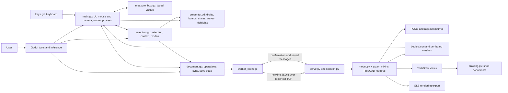

# Shop Sketch architecture

This is the map of the current implementation: component boundaries, state ownership, data flow,
communication and persistence. Read it by section when a change crosses those boundaries.
Implementation below was checked against `main` at `950a030`; later feature branches may add to it.

## Documentation ownership

| Question | Read / maintain here |
|---|---|
| How do I install and use the app? | [README.txt](README.txt) |
| How does a worker take and finish a job; what does the integrator do? | [BOARD.md](BOARD.md) (the queue, workers' steps, the job table); the integrator's work (lock, watch, review, merge, the map) in [docs/integrator.md](docs/integrator.md) |
| What development workflow and test commands apply? | [CLAUDE.md](CLAUDE.md); Codex-specific instructions in [AGENTS.md](AGENTS.md) |
| What local rules, traps and tests apply to this part? | [Worker guide](worker/CLAUDE.md), [viewport guide](viewport/CLAUDE.md), [tool guide](viewport/tools/CLAUDE.md) |
| How do components fit together; who owns state and durable data? | This architecture map |
| What has William approved, and what work is open or done? | [Decision log](docs/decision-log.md) (live) and [its archive](docs/decision-archive.md) (history), edited directly in the repo (P09, P23) |
| What does the other agent need to know about a delivery? | [Handoff](docs/agent-handoff.md) (rules and open list; each open entry a file in docs/handoff/, T77); resolved exchanges in its archive |
| What is proposed, and what native capabilities could support it? | [Suggestions](<Codex's suggestions.md>), [design specs](docs/specs/U01-history.md), [FreeCAD feature map](FREECAD_FEATURE_MAP.md) |

Keep each rule or status in its owning document and link to it elsewhere. Decision IDs connect this map
to the rationale; active decisions govern. Branch delivery notes and test-run totals belong in the Work
list or handoff, not in the current system description. Architecture updates follow the shared workflow
in CLAUDE.md; local implementation rules stay in the folder guides.

## System overview

Shop Sketch is a local desktop application with one Godot process per window, a shared FreeCAD worker for compatible windows, and file-based geometry transfer (W13). Godot handles the immediate modelling experience. A long-running Python worker inside FreeCAD performs authoritative geometry operations. Native FCStd documents remain editable outside Shop Sketch. Blender is an intended rendering consumer, not the modelling engine.

TCP carries commands/status and output paths. Geometry is read from shared local files. This is not currently a remote-worker protocol: the client and worker assume access to the same filesystem.

## Where responsibilities live

| Location | Current responsibility | Useful entry points |
|---|---|---|
| `viewport/project.godot`, `main.tscn` | Godot configuration and startup scene | Main scene |
| `viewport/main.gd` | Composition root: UI (the toolbar's tool segments and the Tools menu built from the tool registry), mouse/trackpad input and camera (key presses go to `keys.gd`), worker lifecycle, model switching and rejection bookkeeping. Routes document/selection signals to presentation; forwards legacy `m.*` access to their owners where callers remain (`_lines` for node callers, `_begin_wave` for reloads, `draft_bboxes` and `force_reject_next` for the recorded suites; the unused geometry, collision, marker, cache and wave forwarders went in H101; Move itself is context-only since T88 step 6). | `_ready`, `_make_tools`, `_make_tool_context`, `sync`, `_on_worker`, `_on_synced`, `_on_op_removed`, `_apply_confirmed`, `switch_model` |
| `viewport/document.gd` | Owns desired ops, IDs (T67, H059: `next_id(prefix)` is the only allocator, `<prefix><friendly serial>_<32 hex: 128 random bits>`, checked against `reserved_ids`, which outlive undo, rejection, reload and reopen and are cleared only by `reset`; the counters number boards and assemblies for their readable names only, restored from every reserved ID; `board_name` / `readable_ids` keep the random part out of status, tooltips and rejections), request sequencing/coalescing, confirmation, undo/redo, model path and save revisions, and the outside-save state (A36: `outside`, `outside_seq`, `dropped`). Reports by signals (`outside_waiting`, `reloaded`, `kept_mine` among them); no geometry or camera. | `sync`, `on_sync_reply`, `on_opened`, `on_saved`, `on_outside_save`, `on_link_up`, `reset`, `open`, `remove_op(s)`, `undo`, `take_redo`, `next_id`, `reserve_values`, `restore_counters` |
| `viewport/presenter.gd` | Owns drafts, loose lines (`loose_lines`, rebuilt on open/undo/redo) and drawn regions (`drawn_region`, the Push/Pull hover cell), confirmed board geometry and nodes, cached visible states, waves and highlights, and the rendering constants (`DEFAULT_BASE`, `SNAP_COLORS`, `AXIS_COLORS`; Main keeps the old names); a unit's joined triangles (`unit_tris`; Main's `unit_tris` forwards) and Select's drag-box Panel (`selection_box` / `clear_selection_box`, reached through `ToolContext.view`, T88 step 2). Reads selection. Owns the mesh, line-strip, collision and snap-marker helpers (`tri_mesh`, `line_mesh` (a line strip's mesh, for a node already in the scene: previews, mirror outlines, guides; H101), `lines` (a new node around `line_mesh`), `add_collision`, `show_marker`; T88 step 5), Push/Pull's face highlight, Move's guides (`draw_guides` / `clear_guides`, lifted from Main) and mirror preview (`mirror_preview`, T88 step 6), and `present_draft` (a committed draft, Push/Pull's and Move's: its root and pieces, pick collisions, prediction caches, the pushed profile consumed, replaced confirmed bodies hidden, the wave started and attached to the drafts or the confirmed bodies). `draft_tests` (`DraftTestRecorder`, test mode only; was `push_tests`) records new boards' draft bounds for Push/Pull and Move and holds the forced-rejection filter, applied to the op copy before it is appended while the draft uses the original. Emits board metadata and completed rejections. | `apply_confirmed`, `show_confirmed`, `show_state`, `forget_op`, `register_rect` (rectangle or circle), `register_line`, `lines_on`, `drawn_region`, `circle_geometry`, `present_draft`, `tri_mesh`, `line_mesh`, `lines`, `add_collision`, `face_highlight`, `begin_wave`, `attach_wave`, `step_waves`, `apply_context`, `show_selection`, `show_siblings`, `reset` |
| `viewport/selection.gd` | Owns selection, entered context, confirmed board relationships, hidden state and predicted deleted IDs. Appends selection-related ops through the document; reports changes without drawing. | `set_boards`, `unit_of`, `in_context`, `edit_blocked`, `enter_context_of`, `leave_context`, `set_selection`, `refresh_hidden`, `is_hidden`, `delete_selected`, `hide_selected`, `unhide`, `make_assembly`, `linked_op` |
| `viewport/keys.gd` | Keyboard (T75): shortcuts, tool keys (from each tool's `TOOL`, via `m.tool_keys`), Esc, Enter, Delete/Backspace (I48), typed characters into the measurements box, Tab/⌥ for Push/Pull before the GUI (I40). Holds no state; main's `_input` / `_unhandled_input` stay the entry points and hand it key presses after the shared prefix (a press drops a pending length; Esc cancels a Properties pick). | `before_gui`, `press` |
| `viewport/measure_box.gd` | Measurements box (VCB, T75): owns the typed text, `typing` (I48), the box's label/value/styles and pending `length` requests; routes count syntax to tools, evaluates lengths locally (`units.gd`), sends what it declines as `length` (with the model's unit as `default_unit`, I59) and drops stale replies. Owns the display units (T66, I57): the window's choice, the last units used (`user://settings.cfg` `[units] last`, not in test mode), `set_units` to the worker (resent after an open or reconnect if unanswered) and the `units` of open / reload replies. Main forwards `m.vcb`, `m.typing`, `m.apply_vcb()`, `m._update_vcb()`, `m.length_pending`, `m.ui_vcb_box`. | `build`, `update`, `apply`, `on_length`, `type_char`, `backspace`, `stop_typing` |
| `viewport/tool_registry.gd` | The tool registry: every `tools/*.gd` declaring a `TOOL` constant (id, label, tip, key, order, optional `show_links`) is a tool, listed with `ResourceLoader.list_directory` so the exported pack (`.gd.remap` / `.gdc`) lists the same; checks for repeated ids/keys. A new tool is one new file; nothing shared lists the tools | `found`, `menu_label`, `problems` |
| `viewport/tools/tool.gd` | Common tool interface, the shared press-and-drag / click-and-click rule (I43). Every tool gets only the tool context (`setup_context`, A40): the legacy Main setup (`setup`, `m`, `infer`, `uses_main()`, the Main preload) went in T88 step 6 | `setup_context`, `reset`, `click`, `double_click`, `release`, `mouse_moved`, `key`, `typed`; `press_started`, `press_moved`, `press_released` |
| `viewport/tools/select_tool.gd` | Click/Shift-click and window/crossing selection of context units; entering editing contexts (context-only, T88 step 2: projection through `pick.project`, reads through `model` / `selection`) | Tool event methods, `box_ids` |
| `viewport/tools/paint_tool.gd` | Paint selected wood onto the picked board/family | Tool event methods |
| `viewport/appearance.gd` | Wood library (`materials.json`, library order), the current Paint wood and the paint command (T88 step 1): makes `set_material` ops through `ToolContext.DocumentCapability` (`next_id` / `append` / `sync`) and emits `status` after the sync, which Main routes to `_say_status`. Wood rendering, the Wood menu and T grain rotation stay in Main, which keeps `wood_library` / `wood_keys` / `paint_material` as forwarding aliases | `load_library`, `select_wood`, `current_name`, `apply`, `status` |
| `viewport/preferences.gd` | The preferences file (I63, T111 step 1): a standalone RefCounted, no Main or nodes; the caller passes the path. `DEFAULTS` (the default units, kept as given, and the feel tunables at their built-in values) and `RANGES`; `load_from` gives values, problems and the tuning keys changed, keeping the last good values for a file or key it can't use (RELEASE_DEG never below INFER_DEG); `changed_on_disk` is a stat-only poll; `write_defaults` never overwrites. Not wired in yet (step 2, H103) | `load_from`, `changed_on_disk`, `write_defaults`, `DEFAULTS`, `RANGES` |
| `viewport/tools/rect_tool.gd` | Rectangle interaction, preview and operation creation; context-only (T88 step 4: picking, snapping and the ray through `pick`, corners through `tool_geometry.gd`'s `rect_points`, the profile's board through `model`, preview and marker through `view`, the op through `document` and `view.register_profile`) | `commit_rect` |
| `viewport/tools/circle_tool.gd` | Centre/radius gesture, typed radius, faceted preview and exact circle operation creation (T81); context-only (T88 step 3: picking and snapping through `pick` (`hit`, `snap`, `on_grid`, `ray`), the profile's board and preview disc through `model`, preview and marker through `view`, the op through `document` and `view.register_profile`); declares its toolbar/menu/key/order/link tint through `TOOL` (A34) | `TOOL`, `commit_circle` |
| `viewport/tools/line_tool.gd` | The first context-only tool (T82, I58: no Main access): L, order 37. Click chains (each click ends a segment and starts the next; Esc or the start point ends it) and single press-drag-release; typed lengths along the cursor direction; one saved `line` op per segment, the closing one carrying the loop's `outline` | `TOOL`, `commit` |
| `viewport/regions.gd` | Pure planar region finding (T82, I51): splits intersections, welds at native tolerance with spatial buckets, cancels subdivided internal boundaries, prunes dangling branches, walks bounded half-edges, classifies and bridges holes, finds the cell under the cursor. Checked by `test_regions.gd`; `worker/scenario/99_regions.py` compares its predictions with FreeCAD (P21) | pure functions |
| `viewport/tools/push_tool.gd` | Push/Pull picking, depth inference, preview, through-cut intent; context-only (T88 step 5): it builds the predicted pieces and the wave (origin, geometry, bodies, attach to drafts or confirmed) and hands them to `view.present_draft` | `commit_push` |
| `viewport/tools/move_tool.gd` | Move/copy/mirror gestures, arrays and operation amendments; context-only (T88 step 6, A40: only `ctx` and `Geo`, no Main or inference): committed move, copy, array, mirror and cut-move drafts and waves go through `view.present_draft`, mirror previews through `view.mirror_preview` | `commit_move`, `commit_mirror_move` |
| `viewport/inference.gd` | Shared picking and snapping (including line endpoints, midpoints and edges, T82), visibility checks, axis/plane destinations, camera rays and projection in model space; owns the grid and snap settings (`GRID`, `SNAP_PX`). Its inputs are explicit, wired once by Main: camera, physics world, presenter caches (read only), selection's `is_hidden`, the grid toggle; it holds no Main reference | `pick`, `snap`, `on_grid`, `point`, `axis`, `axis_dest`, `plane_dest`, `ray`, `project` |
| `viewport/tool_context.gd` | What a tool may use (T88, [spec](docs/specs/T88-tool-interface.md)): seven capabilities (`pick`, `model`, `selection`, `document`, `view`, `ui`, `paint`), each an adapter holding its owner privately and answering with snapshots; no Main, controller, node, material or cache map escapes (allowlist in `test_tool_context.gd`). Built once by Main (`_make_tool_context`); where a body still lives in Main (the tooltip) it calls a narrowly bound Callable; `view.guides` / `clear_guides` go straight to the presenter (mesh/line helpers and the marker are the presenter's; `view.preview` takes `line_mesh` for its outline, so a redraw makes no node, H101); `paint` delegates privately to `appearance.gd`. Every tool is built on it: Line (T82), Paint, Select, Circle, Rectangle, Push/Pull and Move (T88 steps 1-6) (`view.register_line` takes a deep copy; `model.lines_on` and `model.drawn_region` answer snapshots; `view.present_draft(op, pieces, wave)` presents a committed draft; in test mode `document.append` runs the Push test filter on push_pull copies); `view.mirror_preview(tris, corners, axis)` came with Move (step 6); `ui.format_length(mm)` shows a length in the model's units (T66): tools format `vcb_value` only through it | `pick.*`, `model.*`, `selection.*`, `document.next_id` / `op` / `append` / `remove` / `sync`, `view.*`, `ui.*`, `paint.*` |
| `viewport/tool_geometry.gd` | Pure static geometry for tools, inference and Main: unit conversion, op rounding (`arr3`, 0.001), plane bases, rectangle points, prisms, feature edges, unique corners, reflections. Main keeps wrappers under the old names (`m2g`, `_rect_pts`, `_ekey`, `_axis_vec`, `_mirror_tris`, ...) | `m2g`, `g2m`, `arr3`, `plane_basis`, `prism`, `feature_edges`, `reflect_tris` |
| `viewport/worker_client.gd` | TCP framing, buffering, reconnect, pending sends and link signals | `send`, `_process`, `_drain` |
| `worker/replay.py` | Entry point only: puts worker/ on sys.path and calls `serve.main()` (freecadcmd runs it by name) | `main` |
| `worker/common.py` | Shared basics imported explicitly by name (T50): FreeCAD vector alias, tolerances, `OpError`, `vec`/`unit`, `add_props`, `Frame`, wood cards | `material_card`, `Frame` |
| `worker/model.py: Model` | Reading the document and the building blocks (boards, planes, extrusions, booleans, Tip); combines the action mixins (`action_mixins()`: every top-level `*Actions` class in a worker module, found by reading the sources with `ast` before importing; a name defined by two mixins is an error); validates each op (`HANDLERS` = the `op_<type>` methods) | `apply`, `HANDLERS`, `action_mixins`, `resolve_face`, `edit_frame`, `boolean` |
| `worker/circle.py` | Auto-discovered `CircleActions`: exact fully constrained sketch-circle profiles, world/definition placement and native base cloning for Push/Pull (T81). Shares legacy `RectId` identity. | `op_circle`, `circle_feature`, `circle_world` |
| `worker/line.py` | Auto-discovered `LineActions` (T82): each segment a fully constrained native Sketcher line tagged `SSLineId` in the `Lines` group; a simple closed outline also makes a `Part::Feature` profile (`RectId`, `SSRole=line-profile`) that Push/Pull treats like a rectangle; region pushes (`region_face`, `native_region`: straight boundaries extrude the submitted polygon, curved source edges are refined with native face slices along the saved lines, keeping exact arcs) | `op_line`, `polygon_face`, `region_face`, `native_region` |
| `worker/push.py`, `move.py`, `mirror.py`, `assembly.py`, `paint.py`, `visibility.py`, `deletion.py` | One mixin per kind of action (`PushActions`, ...; joins `Model` by being a top-level `*Actions` class), working through `self` on the document: rect + rectangle/circle/line-profile push/pull + through-cuts + drawn-region pushes (`target.region`: validated coplanar, simple, inside its source; then the usual join/cut or separate board, through definition frames for linked or mirrored stock, one op and one undo transaction); move, copies, links, arrays, detach, make unique; mirrors; assemblies; paint and grain; hide/unhide (T28); dependency-preserving deletion and original promotion (T34) | `op_*` (one per op type; helpers aren't named `op_`), `show_as_hidden` |
| `worker/export.py` | What the viewport and renders read: bodies.json entries, per-board mesh files and their caches, model.glb, the TechDraw page | `mesh_of`, `board_mesh_file`, `write_glb`, `cuts_of` |
| `worker/session.py: Session` | Live document, applied operation sequence, display units (`units`, T66: Meta `ShopSketchUnits`, written at every save, kept across rebuilds, read on open and reload; `set_units`, not an op), undo/rebuild, external-edit detection, journal, saves (incl. GuiDocument.xml), save generations and recovery (A32), outside saves (A36); the document-wide ID registry (`IdRegistry`, T67: every string in the ops and `reserved_ids`, seeded from native BodyId/RectId/SSOp/AssemblyId/SSLineId; a new random ID is refused if it collides or changes owner, legacy serial IDs pass as before) | `sync`, `_apply`, `_open_existing`, `export`, `save`, `IdRegistry.accept`, `seed_native`, `recover_generation`, `generation`, `_write_floor_copy`, `_rebuild`, `outside_sig`, `same_bytes`, `mark_outside`, `reload_outside`, `copy_outside_aside`, `aside_name` |
| `worker/serve.py` | select-based multi-client loop; sessions and single-window ownership by absolute file path; delayed saves and focus notifications; the model-file watch (`WATCH_S`, A36) and the `reload` / `keep_mine` commands | `handle`, `claim`, `let_go`, `release`, `save_pending`, `session_for` |
| `worker/materials.py` | Twelve-species wood library, FreeCAD card installation, texture metadata | `install`, `write_library`, `SPECIES` |
| `worker/drawing.py` | Compose shop drawings and cut list from exported data | Script entry point |
| `viewport/*.gdshader`, `line.gdshaderinc` | Draft/confirmation appearance, depth-biased overlays and anti-aliased lines | Shader parameters |
| `viewport/tests.gd`, `viewport/tests/`, `worker/test_*.py`, `worker/scenario/` | Test-mode dispatcher; shared UI harness, separate suites and quick sections; worker geometry/persistence tests | Suite entry points |
| `tools/featuretest.sh`, `quicktest.sh`, `fulltest.sh`, `compare_suites.py` | Test orchestration and geometry comparisons (feature tests without a window; UI tests in the viewport, P07). `quicktest.sh` and `gate.sh` first run `job.py guard-checkout` (T102): a session holding a job is refused in the main checkout and told its worktree; read-only on the queue and fail-open; `SHOPSKETCH_ANY_CHECKOUT=1` overrides. Each stage prints a start line and a timed end line (`run_stage`; the gate forwards its children's `quick:` / `full:` lines live), and in a linked worktree every script's temporary folder goes under its `scratch/` (`set_test_tmpdir`; both helpers in gate.sh, which the others source; T106) | Shell entry points |
| `tools/build_app.sh`, `export_presets.cfg` | macOS application packaging; after signing it runs `test_tools.gd` inside the built pack (the registry finds every tool there and makes each with a tool context) | App build |

Every tool is context-only since T88 step 6 (A40): a tool gets `tool_context.gd`, whose adapters are the isolated boundary, and no Main. Main runtime-loads tools/tests while those scripts preload Main for typing, avoiding preload cycles; `tool_context.gd`, `tool_geometry.gd`, `inference.gd` and `appearance.gd` never reference Main, so Main preloads them.

`viewport/tests.gd` selects a UI suite by the existing command-line flags and loads it at runtime.
Each suite in `viewport/tests/suites/` and each section in `viewport/tests/quick/` is a RefCounted scenario
using one shared `tests/harness.gd` Node per window. The harness owns simulated input, pacing, assertions,
quick-test totals and section timing; it references the same Main throughout the run. `tests/quick_runner.gd`
owns `QUICK_LANES` (unlisted section files join the shortest lane; a listed name with no file fails), loads sections in their original order and passes that harness to each, preserving
sections that continue from the preceding state. Helpers that await frames remain on the harness in the scene tree.

`worker/test_scenario.py` discovers numbered `worker/scenario/NN_feature.py` files in lexical order (T76), validates their declared earlier-file prerequisites, and calls `run(ctx)`. `scenario/context.py` owns the live fixture session, snapshots, checks and shared story actions; feature files import helpers explicitly and publish cross-feature operations through `ctx.actions`. Missing prerequisites fail before opening the fixture; new feature files need no shared registration.

### Typed lengths and the Properties panel (T32, T46)

| Location | Responsibility | Entry points |
|---|---|---|
| `worker/length_input.py` | Normalize supported measurement notation; evaluate numeric lengths using FreeCAD in a temporary unsaved document; return finite millimetres | `evaluate`, `handle` |
| `viewport/measure_box.gd` length input (moved from main.gd in T75) | Route count syntax to tools; evaluate supported lengths/arithmetic locally; send declined input as an asynchronous `length` request and reject stale results | `apply`, `on_length`, `length_pending`, `length_id` (main forwards `apply_vcb`, `_on_length`) |
| `worker/object_properties.py` | Describe native property types, values, formulas and permissions; validate and apply a journalled property edit | `related`, `describe`, `inspect`, `apply` |
| `viewport/property_panel.gd` | Selected-piece feature picker, property fields, Value/Expression modes, reference insertion and read-only details | `display`, `message`, `refresh_requested`, `edit_requested` |
| `viewport/main.gd` property additions | Tie inspection to model/selection/sequence; append property edits to `ops`; refresh after confirmation | `_request_properties`, `_on_properties`, `_edit_property` |

The `length` and `inspect_properties` requests are handled in `serve.py`; `property_edit` is a `Model.HANDLERS` type through `op_property_edit` (delegating to `object_properties.apply`) in `model.py`. Both modules are covered by worker identity hashing and app packaging.

## State ownership and authority

| State | Owner | Meaning |
|---|---|---|
| Pointer gesture, typed input, hover, preview | Godot tool / main | Provisional user interaction |
| Desired operation sequence | Godot `document.gd` `ops` | What the client wants the worker to materialize |
| Selection, entered context, hidden set, board relationships as last confirmed | Godot `selection.gd` | What a click stands for; the hidden set follows `ops` at once, deleted IDs follow `delete` ops at once; the relationships follow `bodies.json` and its cached snapshots on undo/redo |
| Accepted geometry and model relationships | Live FreeCAD document | Authoritative computed model |
| Saved model | `.FCStd` | Durable native model, including Shop Sketch properties |
| Replay/provenance information | Adjacent `.shopsketch.json` | Operations, statuses, revision and FCStd hash |
| Meshes, bounds, metadata, GLB, drawing outputs | Derived export files | Rebuildable presentation/export products |
| Recently confirmed visible states | Godot `presenter.gd` `_states` / `_boards` | Fast geometry and relationship-metadata restoration together; not durable model history |
| Undone actions available to redo | Godot `document.gd` `redo_stack` (T31) | Linear and in memory only: valid while `ops` still has the key recorded at the undo; any other change ends it. Branch history (U01) will replace it |
| Last project preference | Godot `user://settings.cfg` | Application preference |

An operation being confirmed does not mean it has been saved. A visible draft is not an accepted solid. A mesh snapshot cannot restore the full feature graph.

## Lifecycle of an edit

1. A tool receives input through Main and uses the shared inference engine.
2. It renders a draft immediately and commits a semantic operation into `ops`.
3. `sync()` (the document controller's) advances `seq`, marks the desired state dirty, and sends when no request is in flight. Further edits coalesce into a subsequent full-log request.
4. `Session.sync()` compares canonical operation values to the applied sequence, preserving their common prefix.
5. The worker undoes the old tail and applies the new tail. If available FreeCAD undo cannot reach the required state, it rebuilds: from an empty document when there is no undo floor, else from the floor copy (A38: `<model>.floor.FCStd`, the document as FreeCAD's change left it), replaying only the ops above the floor; a missing or mismatched copy refuses the sync.
6. Each applied operation runs in a FreeCAD transaction. Failure aborts that operation and records a failure status.
7. Export writes current metadata and changed board meshes. The worker responds with per-operation status and output directory.
8. The document controller passes on only a response for the current `seq` with nothing newer waiting (`synced`); only the reply to the request in flight clears `in_flight` (T70); main then applies it, replaces drafts with confirmed board nodes, and runs acceptance/rejection feedback. Rejection handling also considers dependent operations; review `_on_rejected` when adding new operation kinds.
9. After approximately 0.25 seconds of socket inactivity, the worker saves pending documents and sends a separate `saved` notification. Flush/quit paths also drain pending saves.

The current client gates sync results using sequence and dirty state. Main routes replies by `cmd`: only `sync` replies reach `on_sync_reply`; lifecycle replies (flush, hello, bye, quit) never touch sync state. An `open` carries its own `seq`, and its reply (success or refusal) counts only if it echoes the latest open's `seq` and the current model (`document.gd:is_current_open`, T70). New asynchronous work must preserve this discipline. Future branching history should additionally identify the exact requested history state and model generation.

### Typed length evaluation

`apply_vcb()` keeps Move copy/divide commands (`3x`, `x3`, `*3`, `/3`) in the tools. Other Rectangle, Push/Pull, Move and mirror inputs are first worked out by `viewport/units.gd` `evaluate_length` / `evaluate_pair`, a port of `length_input.evaluate`: the same rewriting steps, then FreeCAD's rules for this subset (left-to-right `^` after a leading minus, trig in degrees, a unit belongs to the number before it, unit mismatch and division by zero refused). It answers at once, so drafts never wait for FreeCAD, including arithmetic (`5in + 23mm`, `1'-6"` = 6", I35). When unsure (a unit power such as `2mm^2`, a unit after a bracket, `pi mm`) it declines, and the input goes through a `length` request; FreeCAD also supplies the error message for bad input. Rectangle splits its two values at the comma. Decimal commas are therefore not supported by this input path. The viewport sends `default_unit: "mm"`; it does not yet provide a unit-preference UI.

`length_input.evaluate()` normalizes supported mixed fractions and compound imperial measurements, then calls FreeCAD's full `evalExpression` on a temporary feature in an unsaved document. It restores the previous active document afterwards. Unitless results acquire the requested default unit; other results must be finite lengths. This restricted numeric evaluator does not expose model-property references. It supports a fixed set of units/functions, not the whole FreeCAD expression language. I35 makes minus subtraction: `1-1/2"` is half an inch, while `1 1/2"` is one and a half inches. The two must never disagree. The shared [length fixture](tests/length_cases.json) checks agreement between FreeCAD and the local evaluator; coverage and regeneration instructions belong to the folder guides. The older `parse_length` / `parse_pair` stay in `units.gd` but aren't the input path.

FreeCAD evaluation is asynchronous from Godot's perspective but runs serially in the same worker as geometry, so a declined entry can wait behind a recompute (what the local evaluator answers never does). Main holds the current draft steady and records the tool, model, sequence and tool state with the input ID. New keypresses, clicks or tool changes cancel the pending input; replies must still match that context before reaching `typed()`. Length replies bypass the geometry-sync response path and must not clear its in-flight state. Parsing itself creates no model action, undo step or persistent formula.

### Native property inspection and editing

Plane fits (I40, T53). `worker/plane_fit.py` describes rectangular stock using its
base rectangle, extrusion direction, local dimensions and world frame. The inspection snapshot includes these
frames and native labels under `boards`. Properties captures a viewport face click for the active dimension.
The panel previews four corner rays intersecting the selected face's infinite supporting plane. The worker
independently solves those intersections and builds a solid with a square or sloping end. A `property_edit`
with mode `plane_fit` records the source and target BodyIds, local axis, semantic face and end condition.
The board's new Part::Feature tip stores its source extrusion link and the relationship. Model.apply updates
only fits whose source/target stock frame, label or fit settings changed (including native expressions),
propagates to dependent fits, and recomputes the fit batch once inside the transaction (T54). A `replace_fit`
edit restores the native extrusion with the entered dimension. FreeCAD can open the saved solid directly. Updating the fit requires the Shop Sketch
worker. The prototype supports one fitted dimension per plain rectangular board and rectangular targets.

Session.export includes the rectangular stock frame and current label in each
eligible bodies.json entry (`stock_frame`; `presenter.gd` keeps them as `stock_frames`, remembered with each confirmed state). Push/Pull uses the inference engine's corner, edge and edge-midpoint snaps and this frame to rank reachable
adjacent planes by alignment with the push, breaking ties with the last hovered face. Tab cycles the candidates.
⌥ Option cycles the end condition (I41). Committing a click carries the semantic target in `push_pull.edge_fit` (`target_body`, `face`, `fit_mode` 0 Butt / 1 Slice / 2 Fully reach; absent = Butt) and builds the source and fit in one
transaction. A fit on the low end anchors the opposite end through SSReverse. A direct hit on a different stock face can also create the link. A corner can supply up to three reachable planes. Typed pushes retain their numeric distance. Clicking a dimension text field arms a
one-click reference to a face, corner, edge or midpoint. The click commits the most aligned reachable plane with the
selected fit mode. The explicit picker still previews before Apply. Confirmed and restored viewport meshes
refresh selection tint and discard idle hover geometry. For a numeric pull of an entire ordinary stock face the viewport sends
`push_pull.resize_stock`. The worker changes the native dimension and anchors the opposite end. Earlier journals
without this flag replay their original Boolean feature history. A face push on a fitted board's tied end detaches the fit (I26b, I40): a square end is restored to
the native extrusion at its current length and resized; a sloped end keeps its shape with an empty `SSTargetId`.

Select one piece and open Properties. The panel lists the piece and its native dependency chain, including shared component definitions; it can also insert native object names into expression fields. FreeCAD owns the property schema, value and expression. Godot holds an inspection snapshot and provisional edit text, not an independent property database.

The supported editors cover labels, scalar dimensions, integers, booleans, enumerations and vectors, including local placement translation. Internal names/IDs, structural links, protected metadata, rotation and unsupported/computed types are view-only. Other native fields remain available in expandable details. The panel currently handles one selected piece, not bulk edits. Editing a shared feature affects its linked family; coordinates are local to the owning feature/parent, not automatically world coordinates.

A property edit is a normal `property_edit` operation appended to `ops`, not a separate write request. It records `body`, native `object` name, property path, `mode` (`value` or `expression`), input `value`, and the inspected `{value, expression}` as `expected`. The worker checks that the object is still in the piece's dependency chain, the property is writable and the expected snapshot still matches. The UI supplies `expected`; the worker schema currently permits its omission for programmatic callers.

Expression mode uses the native object's `setExpression`, preserving references such as `Rect001.Length * 2`. Value mode evaluates the input, deliberately clears an existing formula, and assigns the property. The UI explicitly identifies this replacement. Length values use the measurement adapter; persistent formulas use native FreeCAD expression syntax. `Model.apply` recomputes and validates; Session's existing transaction abort rolls back rejected edits, including cycles. Changes follow normal export, confirmation, autosave and journal replay; affected bodies conservatively include every model body because references may reach other pieces. No new journal format or sidecar property store is introduced.

Inspection waits for settled geometry. Main checks the request ID, model, selected body, sequence and dirty/in-flight state before accepting a snapshot; property submissions also require the same confirmed sequence. Switching models clears selection and invalidates the inspection state. Property operations participate in rejection-reference tracking and counter restoration. Undo/redo and reopening run through the existing Session machinery.

## Protocol at a glance

Transport: UTF-8 JSON objects separated by newlines over localhost TCP. Main probes port 7878 with hello and compares the protocol version (`protocol`, defined once per side: `serve.py PROTOCOL_VERSION`, `main.gd PROTOCOL_VERSION`; bumped when a message or file field changes, docs/protocol.md) and the worker identity: the MD5 of every worker `.py` except `test_*`, in name order (`serve.py worker_identity`; main.gd `_worker_identity` computes the same, and a quick-test step checks they agree). A worker matching both is shared; another protocol version (`_worker_of` logs it), a different identity or an occupied port gets a private worker. Test mode starts its own worker with `SERVE_PORT=0`: the worker binds a port the system picks and writes it to `SERVE_PORT_FILE` (written whole, via rename), which the window reads before connecting, so concurrent test runs can't take the same port (T47; `tools/fulltest.sh` and the socket tests start theirs the same way). `--port=N` selects an external worker.

| Command/event | Purpose |
|---|---|
| `hello` | Return app identity, worker script hash and process ID for compatibility probing |
| `open` with `model`, `seq`, optional `fresh` | Open/adopt a session; returns operations, revision, external-edit flag and undo floor, echoing `seq` and the absolute `model` (refusals too) |
| `sync` with `model`, `oplog`, `outdir`, `seq`, optional `drawing` | Materialize desired operation sequence and export metadata/meshes |
| `replay` | Fresh-session replay path |
| `flush`, optional `model` | Save pending work now (only that model's, when given); the reply lists what it saved and couldn't (`saved`, `failed`), ok only when nothing failed (T79) |
| `bye` | Save and release this connection's model, then disconnect this window (same save lists) |
| `quit` | Save and stop only if no other client remains; otherwise release the requesting client (`stopped: false`) |
| `focus` / `already_open` | Notify the owner to come forward; refuse the second opener. A newly launched duplicate window closes, while File > Open reports the refusal |
| `saved` event with `model`, `rev` | Successful persistence acknowledgement |
| `save_failed` event with `model`, `rev`, `error` | A save failed; it stays pending and is retried on the next sync or flush (T79) |

Every reply to a request echoes the request's `seq` (null if it had none), except `length`, which echoes its own `id`. Events (`saved`, `save_failed`, `focus`) have no seq.

Typed lengths and the Properties panel add:

| Request / operation | Result and routing |
|---|---|
| `length` with `id`, `texts`, optional `default_unit` | Reply `{cmd: "length", id, ok, values}` with millimetres, or `error`; independent of geometry `seq`/`in_flight` |
| `inspect_properties` with `model`, `body`, `seq`, `request_id` | Ownership-checked read; reply echoes `seq`, `request_id`, `model` and includes `properties: {body, objects, references}`; errors retain request identity |
| `property_edit` inside `sync`'s operation list | Native object/property mutation; ordinary per-op confirmation/rejection, export, undo and save path; there is no standalone property-write command |

Each described object includes native `name`, user-facing `label`, type and field records. Fields include property `path`, display `value`, editor `kind`, `editable`, current `expression`, and enumeration choices where applicable. Link references are displayed but cannot be reassigned through this editor.

The loop multiplexes sockets with `select` but executes geometry serially; it is not parallel FreeCAD evaluation. Autosave waits for all windows to be quiet for 0.25 s. `SERVE_IDLE_EXIT` controls exit after the last connection leaves (app startup supplies 10 s; direct worker default 0 disables it). File > New Window (⌘⇧N) opens a distinct Untitled model. Ownership is local to this worker and absolute path; it is not an OS-wide lock against external FreeCAD or another worker version.

`oplog/0.1` uses millimetres; `run_sync` rejects other units. Errors can occur at request level or per operation. The journal format is currently `shopsketch-journal/0.1`. Check `Model.HANDLERS` (the `op_*` methods) and each `op_*` implementation for the authoritative operation schema; there is not a separate comprehensive typed protocol definition.

### Selection operations (T34)

Select resolves whole context units. Left-to-right boxes require all projected triangles of the unit to be contained; right-to-left boxes test triangle/rectangle intersection. Hidden/deleted boards and boards outside the entered context are excluded. Shift adds box results; click/Shift-click keep their existing replace/toggle behavior. Move consumes a selection when its grab point belongs to it; otherwise it resolves the pointed unit as before.

`move` with `selection: true`, `targets: [BodyId, ...]`, `vector`, optional `copy`, `count`, `divide`, `new_ids` and `detach` is one native transaction. A move resolves shared array/mirror sources once through the assembly motion algebra; inside an array, selected copies detach before motion. Copy uses source-major new IDs, one per source per offset. `mirror` uses several BodyIds and the existing plane/replace/new_ids schema. Drafts and confirmation waves contain each affected board. Retyping a multi-copy count/span retains its full target set. A copy that includes every member of an assembly carries `groups: {old AssemblyId: new AssemblyId}` for a single copy, or `groups: {old AssemblyId: [new AssemblyId, ...]}` for a row (T58, I52); group ids are ordered by offset while board ids remain source-major. Each copied assembly has its own group of linked boards. The worker still reads the single-string form in existing journals.

`delete` with `id` and `targets: [BodyId, ...]` removes the selected instances and promotes surviving originals (I46), in one transaction. `selection.gd` appends this op through the document controller and predicts deleted IDs from desired ops; the presenter suppresses their confirmed nodes and pending draft collisions immediately, independently of Hidden geometry. Undo/redo follows the existing document/worker path. Remembered confirmed states now include the board metadata alongside meshes, stock frames and cuts, so restoring geometry also restores selection relationships and entered-row identity; FreeCAD remains authoritative.

## Native model and identity

- A board is an `App::Part` containing native features and a `Tip` pointing at its current result.
- Typical base: `Part::Plane` → `Part::Extrusion`; circular stock uses a fully constrained `Sketcher::SketchObject` (exact circle with editable radius) → `Part::Extrusion`. Loose rectangle and circle profiles share `RectId`, `r` counters, `target.rect` and the presenter's `rects` map. `circle_geometry` draws a 64-sided disk; facets never enter the native circle operation. Circle pushes use point/back-face depth snaps; rectangular-stock plane fits remain rectangular. The quick Circle section compares the actual preview radius and faceted extrusion bounds with FreeCAD volumes/bounds across ground, vertical, tilted, reversed-normal and sub-millimetre cases (P21). Consecutive cuts share a `Part::Cut` with compound cutters; consecutive additions use `Part::MultiFuse`. Older per-operation boolean chains remain supported.
- Cutter identity follows `SSOp`, not the boolean containing it. Use `cutter_of` / `tools_of`.
- Through-cuts carry `SSThrough` and expression-driven extrusion lengths (`through_all`). Do not equate this with complete arbitrary face-attachment support.
- Pocket-floor ties (T59 step 1, H090): a cut into a board whose `push_pull` op carries `to_face` (a point and outward normal on an earlier pocket's floor) is tied to that floor's cutter (`_find_floor_cutter`: an axis-aligned Part::Extrusion cutter in the board's cuts, arrays included, not `SSThrough`, no `LengthRev` expression, its far end at the point). Its `LengthFwd` is a FreeCAD expression (`tie_to_floor`: base-plane `Shape.BoundBox` levels in the container's frame `* 1mm` + the floor cutter's `LengthFwd`), so it follows when that pocket gets deeper or shallower, in Shop Sketch or FreeCAD, chains included. Every draw-on-face cutter gets `SSTiedTo` at creation (the floor cutter's `SSOp`, or `""`); pushing a tied floor again (`_detach_floor_cuts`) clears the expression, keeping its depth (I26b). No floor found: a plain cut. The viewport doesn't send `to_face` yet (step 2).
- Component instances are `App::Link` objects referring to shared definitions. Copying a plain board converts it to a component. Make Unique copies its definition while retaining applicable array placement.
- Array holders are `App::Placement` objects with count, origin, step, span and distribution properties. Member placements use expressions. Detaching clears placement linkage independently of shape linkage.
- Mirrors use `Part::Mirroring`. Linked sources need a compound wrapper to preserve placement with supported FreeCAD versions; use `mirror_source()` rather than assuming `.Source` is the board.
- Assemblies use `App::DocumentObjectGroup` with `SSRole=assembly` and `AssemblyId`, not transformed `App::Part` containers. This avoids FreeCAD link/mirror scope problems. Assembly movement explicitly moves members and their arrays. Assembly rows retain one array holder per source board, with independent origins and expressions tying follower holders' Count/Step/Span to the first holder; native edits of that master spacing move all boards together. `selection.gd` joins existing assembly/row metadata to resolve the whole row outside, an assembly inside the row, and individual boards inside the assembly; leaving an assembly returns to its row. Moving a copied assembly in the entered row detaches every member's placement while retaining shape links (I53). Mirrored members are copied as native mirror chains of hidden linked sources; array expressions drive both their source placements and mirror planes, and detaching clears both. Existing metadata snapshots therefore continue to restore these relationships on undo/redo; no new body-export field is needed.
- Mirror groups are those organizational assemblies with `SSKind=mirror`: outside, movement moves the group; inside, movement reflects between the source and mirrored member and the plane is displayed. Moving the plane itself is not implemented.
- Viewport `unit_of`, `context`, `in_context`, `edit_blocked` and `is_hidden` control whether a picked board represents a part, assembly, or array. Context entry affects picking and appearance.
- Hidden boards (T28, I37) carry `SSHidden=True` on the board object (op `hide` with `targets` and `hidden`; one op per Hide/Unhide command). FreeCAD's undo restores `SSHidden` but not `Visibility`, so ops never set a board's Visibility: `Session.sync` calls `show_as_hidden()` after every change, and the saved GuiDocument.xml follows it. Boards from files older than T28 get `SSHidden` on opening (`add_hidden_props`, outside any transaction). A flip in place and Make unique keep the board's hidden state; new copies start shown. bodies.json carries `hidden`; the viewport works out the hidden set from `ops` itself (`hidden_boards()`), so hide and its undo show at once. Hidden boards are left out of model.glb (renders; unhide to include them) but stay in drawings and the cut list.
- A deleted board (T34, I46) is removed from the document with every object only it used (`DeleteActions.remove_unneeded`, dependencies removed before their dependents so FreeCAD's undo keeps expression links). One that a surviving link, mirror or array still builds from stays as an object with `SSRole=deleted`, removed when its last dependent goes; those are excluded by `Model.bodies()` from picking metadata, GLB, drawings and cut lists. `show_as_hidden()` keeps them invisible in FreeCAD after sync/undo/reopen. For a deleted row source, a surviving member is detached as the new original and all its holders change `SSSource`; origins/indices stay fixed to preserve survivor positions and Nx or /N spacing. Shared definitions retain editable native features, with their `BodyId` promoted to a surviving instance. No new property or journal version is required.
- Lines (T82) are drawings: native Sketcher lines tagged `SSLineId` in a `Lines` group, changing no solid; a closed loop also makes a line profile (`RectId`, `SSRole=line-profile`). Self-crossing chains stay drawings; the viewport finds their bounded cells (`regions.gd`) and Push/Pull sends the chosen cell as `target.region`.
- Identity/metadata include `BodyId`, `RectId`, `SSLineId`, `SSRole`, `SSOp`, `SSMaterial`, `SSGrain`, `SSHidden`, `AssemblyId`, `SSArray`, and `SSArrayIndex`. Labels are presentation; do not substitute labels for stable identity.

Face references are geometric `{body, normal, point}` descriptions rather than face indices. `resolve_face` finds a planar face matching normal and point containment and rejects missing/ambiguous matches. This avoids reliance on face numbering but does not guarantee persistence through topology changes.

Model coordinates are Z-up millimetres; Godot coordinates are Y-up metres. Use existing conversion helpers. `Frame` and `edit_frame()` translate edits through component placements and mirrors into definition coordinates. New tools must not assume world and local frames coincide.

## Files, persistence and recovery

`Session.save()` exports GLB when an output directory exists and writes one save generation (A32, T40): the new FCStd under `<model>.saving.FCStd` (optionally with TechDraw data through a separate document, then GUI visibility information) and its journal, naming the new file's revision and sha256, under `<model>.shopsketch.saving.json`; it keeps the current pair as `<model>.prev.FCStd` / `<model>.shopsketch.prev.json` (hard links, a copy where links fail); then it renames the new file and then the new journal into place. A whole file-and-journal pair is on disk at every step.

Opening runs `recover_generation()` first (A37: the newest file wins; contents decide, dates only veto going back). A file is readable when its ZIP entries check and its Document.xml parses. A readable main file matching its journal (or the journal's known outside save, A36) opens as before. A readable main file is otherwise kept unless it is identifiably the new file of a save of ours that stopped part way: it matches the .saving journal (the journal is put in place), or its ShopSketchRev is the journal's + 1 and a whole .saving pair of that revision, not older than it, finishes the save. Any other mismatch (e.g. FreeCAD saving an older revision while Shop Sketch was closed, or a lost journal) opens external with A25's undo floor, with nothing reported. Only a missing or unreadable main file falls back to the newest whole pair among the .saving and .prev files. A recovery is reported once in the open reply's `recovered` (`from: "new"` finished a save, `"prev"` fell back to the one before); the save indicator shows it until the next save lands. Displaced files go to the `.unmatched` names; nothing of either pair is deleted. For planned external-edit watching/merging and foreign-solid adoption, see Q19/T17 and Q17/T18 in the decision log.

Outside saves (A36, T64). `serve.py` stats each owned model's file every `WATCH_S` (0.25 s, on the select loop's timeout: one stat per model). A changed (mtime, size) counts once it has held still for one look and its bytes differ from what the Session last read or wrote (`same_bytes`); `save_pending` also looks just before each save, without the wait, and skips a held model, so no autosave goes over FreeCAD's save. On seeing one the worker holds the model (`mark_outside`: no autosave; the journal gets `outside_sha256` at once, so a new worker after a crash opens FreeCAD's file as an outside edit rather than recovering our `.prev` pair) and sends `outside_save`. The window (`document.gd:on_outside_save`) reloads at once when nothing is pending; otherwise it waits up to `OUTSIDE_SAVE_WAIT` (10 s, `main.gd`) for its syncs to land, then reloads, or asks (`_ask_outside`: Use FreeCAD's version / Keep Shop Sketch's, naming the reason, logged by `_log_worker`). While a reload is out, syncs wait and actions drawn meanwhile go on top of the reloaded ops; `on_link_up` sends no sync while the choice is open. `Session.reload_outside()` reopens the file, keeps the ops the file's revision held (each saved revision's op list, the last 50; else the `.prev` journal; else none), moves the rest to the journal's `dropped` (for T65), sets the undo floor there, and writes the journal naming FreeCAD's file; `main.gd:_on_reloaded` waves over the changed boards. Keep Shop Sketch's (and flush, bye or quit of a held model with unsaved actions) copies FreeCAD's file aside as `<model>.freecad-<YYYYmmdd-HHMMSS>.FCStd` (`copy_outside_aside`, `aside_name`), then saves ours over it. The undo floor is kept in the journal (`floor`) across saves and sessions; `Session.save()` no longer resets it. Whenever the floor is set from a FreeCAD change (opening an externally edited file, `reload_outside`), `Session._write_floor_copy()` saves the document as it then is to `<model>.floor.FCStd` (temp name, then `os.replace`) and the journal records its sha256 and floor (`floor_copy`, A38); `_rebuild` opens that copy (checked against both) instead of starting empty, and saving still writes the model's own path. Models never edited in FreeCAD have no floor copy.

A failed save (T79) leaves the session's revision where it was (`Session.save` rolls it back and removes its temporary file) and stays in the worker's pending saves, marked failed: the timer's autosave skips it, the next sync of that model, a flush, bye or quit retries it. Each failure sends the owner `save_failed`; `document.gd` keeps the reason in `save_error` and the save indicator says "Couldn't save: <reason>" until a `saved` lands (I54). A sync's confirmation is never proof of durability; only `saved` is.

Closing a window (the close button or Cmd+Q: `NOTIFICATION_WM_CLOSE_REQUEST`, auto-accept off) goes through `main.gd:_request_close` and `document.gd:begin_close`: with nothing unsaved it closes at once; otherwise it waits for the sync in flight, sends `flush` with the model, and closes when that answers ok with the latest revision saved. A failed save, or no answer in `CLOSE_WAIT_S`, opens a dialog (native where the system has one): Retry, Close without saving (the journal keeps the actions), Cancel (I55). Other quits (a duplicate window closing itself) still go straight to `_shutdown_worker`.

Main picks/probes/starts the worker (`_pick_worker`), watches loss (`_watch_worker`), and reopens/resubmits after reconnection. With a shared worker, a window waits for the shared port to become free before attempting restart; closing one window sends bye rather than killing everyone's worker. Private app-started workers use quit; test connections are separate. `worker_client.gd` handles TCP reconnection and framing. Preserve ownership when changing recovery.

## Geometry and drawing exports

- `bodies.json` describes current bodies, geometry metadata, appearance and relationship information.
- `meshes/<board>-<key>.bin` stores packed triangle positions, normals, edges and corners. `board_mesh_file` writes it; `_build_board` reads it. Change both ends together.
- The presenter reuses board nodes by mesh filename plus material/grain appearance key and remembers a bounded set of confirmed states (currently 40). Cache eviction must not become history deletion.
- `model.glb` is generated at save time. Material extras include face/end texture paths, real texture size and species; node extras include `grain_zup` and `across_zup`. The export writes base-colour PBR materials plus these custom extras, not ready-wired Blender texture nodes. A Blender consumer must interpret the extras and resolve the texture files; this review does not establish a complete rendered .blend workflow.
- `worker/materials.py` installs FreeCAD cards under the user `Material/Shop Sketch` directory (v1-1 on this Mac). `op_set_material` sets the shared definition's SSMaterial and Tip ShapeMaterial; `set_tip` carries that card forward. SSGrain is definition-local, defaults to the longest axis, and `turn_grain` switches longest/middle axes. Linked siblings share it; export transforms grain/across into world coordinates.
- `materials.json` supplies the viewport library. `paint_tool.gd`, the Wood menu and T grain rotation expose it. `wood.gdshader` uses world position projected along grain/across with physical texture scale and mirrored end-grain repeats; no per-face UV mesh is required.
- TechDraw supplies view geometry. `drawing.py` reads `views.json`, `bodies.json`, and `status.json`, producing SVG/cut-list CSV and, when CairoSVG is available, PDF/PNG.
- The drawing composer currently uses fixed A3 layout and scales. Its existence does not imply arbitrary-page layout or a complete Blender material pipeline.

## Where to implement a change

| Change | Start here | Also review |
|---|---|---|
| New drawing/manipulation tool | New script under `viewport/tools` with a `TOOL` constant (toolbar, Tools menu and key come from it) | Inference, worker handler, rejection dependencies, `test_tools.gd` / quick `registry` expectations, tests |
| Snap/axis/plane behaviour | `inference.gd` | Every tool and coordinate conversion |
| New native geometric feature | An `op_<type>` in the matching action file (`push.py`, `move.py`, ...), or a new file with a top-level `*Actions` class (it joins `Model` by itself); no list to edit | Transaction behaviour, export/cache keys, persistence/reopen |
| Component/array/assembly semantics | Model relationship helpers | Main editing context, previews, affected-instance highlighting |
| Material pipeline | `worker/materials.py`, `op_set_material`, `set_tip`, `grain_world`, `write_glb` | Paint tool, wood.gdshader, material/grain cache keys and Blender extras consumer |
| Worker failure/reconnect | `worker_client.gd`, Main lifecycle | `serve`, save acknowledgement and model switching |
| Typed measurement syntax | `length_input.py` first, then its port `units.gd` `evaluate_length`, and `tools/length_cases.py` to rebuild the shared table; `measure_box.gd` `apply` / `on_length` (Main forwards `apply_vcb` / `_on_length`) | I35, count commands, request cancellation, parsing versus persistent expressions |
| Native property UI or edits | `property_panel.gd`, `object_properties.py` | Native permissions, shared definitions, units/frames, stale snapshots, transactions, undo/reopen |
| New persistent history | Proposed history owner, not mesh cache | Session replay, IDs, journal schema, external edits, worker request identity |
| Drawing layout | `drawing.py` | TechDraw generation and data schema |
| Packaging/runtime paths | `build_app.sh`, `_beside_project` | Worker and drawing dependencies inside bundle |

For a new operation, define intent, input units/frame, target identity, affected relationships, native representation, validation, undo unit, persistence, and export invalidation before adding UI polish.

## Architectural constraints worth preserving

- Input stays responsive while FreeCAD evaluates; provisional, confirmed and saved states are distinct.
- Each operation has transaction-safe failure and leaves the prior model valid when rejected.
- The FCStd document is authoritative; geometry caches and visible undo states cannot replace durable history.
- Tools share inference and coordinate conversions; world, parent and definition frames are distinct.
- Cross-boundary changes cover both producer and consumer: protocol fields, mesh layouts, cache keys and save/recovery semantics.

For FreeCAD transaction/Draft/boolean traps and viewport drawing rules, use the folder guides linked above.

## Planned boundaries

Current owners are in the component and state tables above. The remaining proposals live in the
[decision log Work list](docs/decision-log.md#work-list): T35–T36 for durable branching history,
[Window ↔ worker protocol](docs/protocol.md) is the comprehensive reference (T44); T50 covers explicit worker imports.
T39/T41/T42/T43/T51 are represented by the existing controllers, worker modules, folder guides and test suites.
See [U01](docs/specs/U01-history.md) for the history design; proposals do not describe implemented behaviour.

## Validation and maintenance

Use [CLAUDE.md#tests](CLAUDE.md#tests) for commands and when to run them; folder guides own coverage
and feature-test extension instructions. Native structure/undo/reopen tests, controller tests and scripted
viewport comparisons validate different boundaries. Visual feel still needs real-hardware checks.
Record actual commands/results against the delivered commit in the Work list or handoff.

`tools/gate.sh` runs quick then full, with one verdict (P18). When quick succeeds and prints its feature/UI
summary, the gate invokes full with `--gate-ui-only`: the quick run owns parsing and feature checks, and
full still owns every recorded comparison and targeted UI suite. After any quick failure, full performs
its own parsing and feature checks as well. Standalone quick/full commands always include those checks.
Timing lines in their logs identify parsing, quick lanes, full lanes/suites, and individual feature tests.

Architecture ownership and the same-commit update rule are defined in CLAUDE.md / AGENTS.md.
Update the affected sections when a boundary, protocol/file format, state owner, persistent relationship,
or save/recovery path changes. Keep this map about the resulting system rather than the delivery history.

### Automated omission checks

[tools/check_architecture.py](tools/check_architecture.py) watches production Python/Godot modules,
project/scenes and packaging, including additions, deletions and renames. The tracked commit-message hook
checks the staged snapshot for an architecture update or a specific `Architecture-Impact: none` rationale.
The workflow in [.github/workflows/architecture.yml](.github/workflows/architecture.yml) checks the whole
PR diff. The local hook checks staging together; the PR check does not enforce per-commit ordering.
Neither check proves that prose is accurate: reviewers verify the map, rationale and same-commit rule.
[Guard tests](tools/test_check_architecture.py) cover staged versus unstaged updates, rationales, renames
and deletion. Hook activation/commit commands belong to the shared workflow; this document does not
change shared Git configuration.

## Native geometry feature mapping

See [FREECAD_FEATURE_MAP.md](FREECAD_FEATURE_MAP.md) for native providers, object types,
workbench requirements, evidence and integration limits. It owns the capability mapping; approved
representation choices and rationale remain in the decision log.
