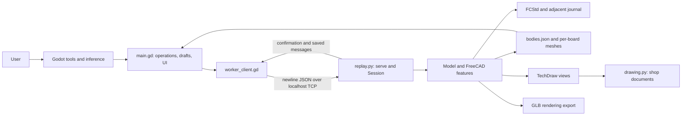

# Shop Sketch architecture

Reviewed: 2026-11-21. This describes the local working tree, including ongoing changes, not a released build. Source and CLAUDE.md were inspected; this documentation task did not execute the app or test suites.

## Reading and decision order

Read CLAUDE.md for project conventions and the decision-log link. This file maps implementation responsibilities and constraints; it does not supersede accepted decisions. Read [Codex's suggestions.md](<Codex's suggestions.md>) for the proposed feature backlog and branching-history design. The remote decision log was inaccessible to Codex (sign-in required), so existing IDs below are those recorded locally in CLAUDE.md.

When behaviour changes, update the decision log as required there, then keep this map and affected tests current. Proposed boundaries below are explicitly labelled; do not mistake them for existing modules.

## System overview

Shop Sketch is a local desktop application with two cooperating processes and file-based geometry transfer. Godot handles the immediate modelling experience. A long-running Python worker inside FreeCAD performs authoritative geometry operations. Native FCStd documents remain editable outside Shop Sketch. Blender is an intended rendering consumer, not the modelling engine.

TCP carries commands/status and output paths. Geometry is read from shared local files. This is not currently a remote-worker protocol: the client and worker assume access to the same filesystem.

## Where responsibilities live

| Location | Current responsibility | Useful entry points |
|---|---|---|
| `viewport/project.godot`, `main.tscn` | Godot configuration and startup scene | Main scene |
| `viewport/main.gd` | Composition root; UI, model state, selection/context, operation submission, drafts, confirmation waves, caches, worker lifecycle, project switching, camera | `_ready`, `_make_tools`, `sync`, `_on_worker`, `_apply_confirmed`, `switch_model` |
| `viewport/tools/tool.gd` | Common tool interface and references to viewport/inference | `setup`, `reset`, `click`, `double_click`, `release`, `mouse_moved`, `key`, `typed` |
| `viewport/tools/select_tool.gd` | Selection and entering editing contexts | Tool event methods |
| `viewport/tools/rect_tool.gd` | Rectangle interaction, preview and operation creation | `commit_rect` |
| `viewport/tools/push_tool.gd` | Push/Pull picking, depth inference, preview, through-cut intent | `commit_push` |
| `viewport/tools/move_tool.gd` | Move/copy/mirror gestures, arrays and operation amendments | `commit_move`, `commit_mirror_move` |
| `viewport/inference.gd` | Shared picking and snapping, visibility checks, axis/plane destinations | `pick`, `snap`, `point`, `axis`, `axis_dest`, `plane_dest` |
| `viewport/worker_client.gd` | TCP framing, buffering, reconnect, pending sends and link signals | `send`, `_process`, `_drain` |
| `worker/replay.py: Model` | Native features, object relationships, geometry operations and validation | `apply`, `op_*`, `resolve_face`, `edit_frame` |
| `worker/replay.py: Session` | Live document, applied operation sequence, undo/rebuild, external-edit detection, export and persistence | `sync`, `_apply`, `_open_existing`, `export`, `save` |
| `worker/replay.py: serve` | Serial request dispatch, sessions by file path, delayed autosave and notifications | `run_sync`, `save_pending`, `session_for` |
| `worker/drawing.py` | Compose shop drawings and cut list from exported data | Script entry point |
| `viewport/*.gdshader`, `line.gdshaderinc` | Draft/confirmation appearance, depth-biased overlays and anti-aliased lines | Shader parameters |
| `viewport/tests.gd`, `worker/test_*.py` | Scripted UI and geometry/persistence tests | Suite entry points |
| `tools/quicktest.sh`, `fulltest.sh`, `compare_suites.py` | Test orchestration and geometry comparisons | Shell entry points |
| `tools/build_app.sh`, `export_presets.cfg` | macOS application packaging | App build |

Tools currently depend directly on `main.gd`; the interface is a convention, not a strongly isolated service boundary. Main runtime-loads tools/tests while those scripts preload Main for typing, avoiding preload cycles.

## State ownership and authority

| State | Owner | Meaning |
|---|---|---|
| Pointer gesture, typed input, hover, preview | Godot tool / main | Provisional user interaction |
| Desired operation sequence | Godot `ops` | What the client wants the worker to materialize |
| Accepted geometry and model relationships | Live FreeCAD document | Authoritative computed model |
| Saved model | `.FCStd` | Durable native model, including Shop Sketch properties |
| Replay/provenance information | Adjacent `.shopsketch.json` | Operations, statuses, revision and FCStd hash |
| Meshes, bounds, metadata, GLB, drawing outputs | Derived export files | Rebuildable presentation/export products |
| Recently confirmed visible states | Godot `_states` / `_boards` | Fast visual restoration; not durable model history |
| Last project preference | Godot `user://settings.cfg` | Application preference |

An operation being confirmed does not mean it has been saved. A visible draft is not an accepted solid. A mesh snapshot cannot restore the full feature graph.

## Lifecycle of an edit

1. A tool receives input through Main and uses the shared inference engine.
2. It renders a draft immediately and commits a semantic operation into `ops`.
3. `sync()` advances `seq`, marks the desired state dirty, and sends when no request is in flight. Further edits coalesce into a subsequent full-log request.
4. `Session.sync()` compares canonical operation values to the applied sequence, preserving their common prefix.
5. The worker undoes the old tail and applies the new tail. If available FreeCAD undo cannot reach the required state, it rebuilds from operations when permitted by the external-edit floor.
6. Each applied operation runs in a FreeCAD transaction. Failure aborts that operation and records a failure status.
7. Export writes current metadata and changed board meshes. The worker responds with per-operation status and output directory.
8. Main applies a current response, replaces drafts with confirmed board nodes, and runs acceptance/rejection feedback. Rejection handling also considers dependent operations; review `_on_rejected` when adding new operation kinds.
9. After approximately 0.25 seconds of socket inactivity, the worker saves pending documents and sends a separate `saved` notification. Flush/quit paths also drain pending saves.

The current client gates sync results using sequence and dirty state. New asynchronous work must preserve this discipline. Future branching history should additionally identify the exact requested history state and model generation.

## Protocol at a glance

Transport: UTF-8 JSON objects separated by newlines over localhost TCP. Default port is 7878; app-managed startup can choose a port, while `--port=N` selects an external worker for tests.

| Command/event | Purpose |
|---|---|
| `open` with `model`, optional `fresh` | Open/adopt a session; returns operations, revision, external-edit flag and undo floor |
| `sync` with `model`, `oplog`, `outdir`, `seq`, optional `drawing` | Materialize desired operation sequence and export metadata/meshes |
| `replay` | Fresh-session replay path |
| `flush` | Save pending work now |
| `quit` | Save pending work and stop worker |
| `saved` event with `model`, `rev` | Successful persistence acknowledgement |

`oplog/0.1` uses millimetres; `run_sync` rejects other units. Errors can occur at request level or per operation. The journal format is currently `shopsketch-journal/0.1`. Check `Model.HANDLERS` and each `op_*` implementation for the authoritative operation schema; there is not a separate comprehensive typed protocol definition.

## Native model and identity

- A board is an `App::Part` containing native features and a `Tip` pointing at its current result.
- Typical base: `Part::Plane` → `Part::Extrusion`. Consecutive cuts share a `Part::Cut` with compound cutters; consecutive additions use `Part::MultiFuse`. Older per-operation boolean chains remain supported.
- Cutter identity follows `SSOp`, not the boolean containing it. Use `cutter_of` / `tools_of`.
- Through-cuts carry `SSThrough` and expression-driven extrusion lengths (`through_all`). Do not equate this with complete arbitrary face-attachment support.
- Component instances are `App::Link` objects referring to shared definitions. Copying a plain board converts it to a component. Make Unique copies its definition while retaining applicable array placement.
- Array holders are `App::Placement` objects with count, origin, step, span and distribution properties. Member placements use expressions. Detaching clears placement linkage independently of shape linkage.
- Mirrors use `Part::Mirroring`. Linked sources need a compound wrapper to preserve placement with supported FreeCAD versions; use `mirror_source()` rather than assuming `.Source` is the board.
- Assemblies use `App::DocumentObjectGroup`, not transformed `App::Part` containers. This avoids FreeCAD link/mirror scope problems. Assembly movement explicitly moves members and their arrays.
- Viewport `unit_of`, `context`, `in_context`, and `edit_blocked` control whether a picked board represents a part, assembly, or array. Context entry affects picking and appearance.
- Identity/metadata include `BodyId`, `RectId`, `SSRole`, `SSOp`, `SSMaterial`, `AssemblyId`, `SSArray`, and `SSArrayIndex`. Labels are presentation; do not substitute labels for stable identity.

Face references are geometric `{body, normal, point}` descriptions rather than face indices. `resolve_face` finds a planar face matching normal and point containment and rejects missing/ambiguous matches. This avoids reliance on face numbering but does not guarantee persistence through topology changes.

Model coordinates are Z-up millimetres; Godot coordinates are Y-up metres. Use existing conversion helpers. `Frame` and `edit_frame()` translate edits through component placements and mirrors into definition coordinates. New tools must not assume world and local frames coincide.

## Files, persistence and recovery

`Session.save()` exports GLB when an output directory exists, writes a temporary FCStd, optionally adds TechDraw data through a separate document, writes GUI visibility information, replaces the model file, then writes its journal with revision and hash.

Each file replacement is atomic; the FCStd and journal are not one atomic multi-file transaction. A crash between replacements can leave a detectable mismatch. Opening compares revision/hash and treats unmatched or externally modified documents conservatively, including an undo floor. Live watching/merging of outside edits and adoption of arbitrary foreign solids are still identified as future work in CLAUDE.md.

Save failures currently log an error in `save_pending`; there is no dedicated save-failure event in that path. Do not interpret confirmation or a missing error toast as proof of durability. Explicit save-error/retry behaviour is a useful future contract improvement.

The Godot app owns worker startup/watch/restart when it launches the worker. `worker_client.gd` owns reconnection; Main responds to link signals and reopens/resubmits as appropriate. Test workers are separate. Preserve this distinction when changing shutdown or recovery.

## Geometry and drawing exports

- `bodies.json` describes current bodies, geometry metadata, appearance and relationship information.
- `meshes/<board>-<key>.bin` stores packed triangle positions, normals, edges and corners. `board_mesh_file` writes it; `_build_board` reads it. Change both ends together.
- Main reuses board nodes by mesh filename and remembers a bounded set of confirmed states (currently 40). Cache eviction must not become history deletion.
- `model.glb` is generated at save time for rendering, not on every interactive update.
- TechDraw supplies view geometry. `drawing.py` reads `views.json`, `bodies.json`, and `status.json`, producing SVG/cut-list CSV and, when CairoSVG is available, PDF/PNG.
- The drawing composer currently uses fixed A3 layout and scales. Its existence does not imply arbitrary-page layout or a complete Blender material pipeline.

## Where to implement a change

| Change | Start here | Also review |
|---|---|---|
| New drawing/manipulation tool | New script under `viewport/tools` | Main registration, inference, worker handler, rejection dependencies, tests |
| Snap/axis/plane behaviour | `inference.gd` | Every tool and coordinate conversion |
| New native geometric feature | `Model` in `replay.py` | Transaction behaviour, export/cache keys, persistence/reopen |
| Component/array/assembly semantics | Model relationship helpers | Main editing context, previews, affected-instance highlighting |
| Material pipeline | `op_set_material`, metadata and exports | Godot appearance, grain coordinates, future Blender mapping |
| Worker failure/reconnect | `worker_client.gd`, Main lifecycle | `serve`, save acknowledgement and model switching |
| New persistent history | Proposed history owner, not mesh cache | Session replay, IDs, journal schema, external edits, worker request identity |
| Drawing layout | `drawing.py` | TechDraw generation and data schema |
| Packaging/runtime paths | `build_app.sh`, `_beside_project` | Worker and drawing dependencies inside bundle |

For a new operation, define intent, input units/frame, target identity, affected relationships, native representation, validation, undo unit, persistence, and export invalidation before adding UI polish.

## Architectural constraints worth preserving

- Never block normal input while waiting for FreeCAD; distinguish provisional, accepted and saved states.
- New operations must have transaction-safe failure and leave a valid prior model when rejected.
- Add FreeCAD properties at object creation where possible; property additions inside transactions have undo caveats documented in CLAUDE.md.
- Set the active FreeCAD document before invoking Draft helpers.
- Use MultiFuse for overlapping additive features; a Fuse of overlapping compound members can miscount volume.
- Apply overlay depth bias in shaders, not moved geometry nodes; moving overlays previously broke picking.
- Use the existing anti-aliased strip-line implementation rather than primitive one-pixel lines.
- Keep test delays, forced rejections and synthetic input hooks confined to tests.

## Proposed evolution, not current implementation

Main currently concentrates UI, model coordination, caches, selection, history-like state, process lifecycle and rendering. Replay combines domain operations, persistence, export and transport. These are practical extraction seams, not a reason for a large rewrite.

As features grow, consider extracting:

1. **Document controller:** current model, operations, request generation, confirmation and save status.
2. **History store:** immutable action nodes, active cursor, branch heads, persistence and checkpoint policy.
3. **Selection/context controller:** selected units, entered assemblies/arrays and affected-instance scope.
4. **Geometry presenter:** draft and confirmed nodes, mesh cache, picking metadata and feedback.
5. **Worker session/export boundaries:** keep transport separate from domain operations, document recovery and derived outputs.

For branching history, retain old futures in a durable graph and materialize an active path through the existing sync interface initially. A 20-row sidebar window is independent of retention depth, FreeCAD's undo capacity and the viewport's 40-state cache. Branch-safe IDs, checkpoints, stale-response handling and external-edit boundaries are prerequisites. Merge should compare semantic dependencies from a common ancestor and preserve both source paths; a successful boolean replay is not sufficient proof of a conflict-free merge. See the suggestions document for staged requirements and acceptance cases.

## Validation and maintenance

For behavioural changes, follow CLAUDE.md: run `tools/quicktest.sh`; run `tools/fulltest.sh` on failure or before merge. Worker tests check native structure, undo/reopen, arrays and relationships. Scripted viewport suites exercise gestures; reference comparisons check volumes/bounds. Visual quality and interaction feel still require real-hardware checks.

This architecture-only addition was checked for referenced paths and Markdown structure. No runtime behaviour changed.

Update this file when adding a module, changing a protocol/schema, moving state ownership, introducing a persistent relationship, or changing save/recovery behaviour. Keep current facts distinct from planned work, and recheck working-tree changes before acting on an inventory.

## Native geometry feature mapping

See [FREECAD_FEATURE_MAP.md](FREECAD_FEATURE_MAP.md) for S01–S16 providers, native object types, workbench requirements, evidence and integration limits. William clarified that SketchUp-style actions should translate to reasonable FreeCAD counterparts, including combinations of operations and downloadable workbenches; custom UI/history are allowed. A one-to-one command or stock-FreeCAD-only implementation is not required. The mapping separates geometry capabilities from custom orchestration and unverified rendering/relationship behaviour.
