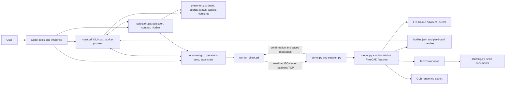

# Shop Sketch architecture

This is the map of the current implementation: component boundaries, state ownership, data flow,
communication and persistence. Read it by section when a change crosses those boundaries.
Implementation below was checked against `main` at `950a030`; later feature branches may add to it.

## Documentation ownership

| Question | Read / maintain here |
|---|---|
| How do I install and use the app? | [README.txt](README.txt) |
| What development workflow and test commands apply? | [CLAUDE.md](CLAUDE.md); Codex-specific instructions in [AGENTS.md](AGENTS.md) |
| What local rules, traps and tests apply to this part? | [Worker guide](worker/CLAUDE.md), [viewport guide](viewport/CLAUDE.md), [tool guide](viewport/tools/CLAUDE.md) |
| How do components fit together; who owns state and durable data? | This architecture map |
| What has William approved, and what work is open or done? | [Decision log](docs/decision-log.md), edited directly in the repo (P09) |
| What does the other agent need to know about a delivery? | [Handoff](docs/agent-handoff.md); resolved exchanges in its archive |
| What is proposed, and what native capabilities could support it? | [Suggestions](<Codex's suggestions.md>), [design specs](docs/specs/U01-history.md), [FreeCAD feature map](FREECAD_FEATURE_MAP.md) |

Keep each rule or status in its owning document and link to it elsewhere. Decision IDs connect this map
to the rationale; active decisions govern. Branch delivery notes and test-run totals belong in the Work
list or handoff, not in the current system description. Architecture updates follow the shared workflow
in CLAUDE.md; local implementation rules stay in the folder guides.

## System overview

Shop Sketch is a local desktop application with one Godot process per window, a shared FreeCAD worker for compatible windows, and file-based geometry transfer (W13). Godot handles the immediate modelling experience. A long-running Python worker inside FreeCAD performs authoritative geometry operations. Native FCStd documents remain editable outside Shop Sketch. Blender is an intended rendering consumer, not the modelling engine.

TCP carries commands/status and output paths. Geometry is read from shared local files. This is not currently a remote-worker protocol: the client and worker assume access to the same filesystem.

## Where responsibilities live

| Location | Current responsibility | Useful entry points |
|---|---|---|
| `viewport/project.godot`, `main.tscn` | Godot configuration and startup scene | Main scene |
| `viewport/main.gd` | Composition root: UI/input/camera, worker lifecycle, model switching, mesh helpers and rejection bookkeeping. Routes document/selection signals to presentation; forwards legacy `m.*` access to their owners. | `_ready`, `_make_tools`, `sync`, `_on_worker`, `_on_synced`, `_on_op_removed`, `_apply_confirmed`, `switch_model` |
| `viewport/document.gd` | Owns desired ops, IDs, request sequencing/coalescing, confirmation, undo/redo, model path and save revisions. Reports by signals; no geometry or camera. | `sync`, `on_sync_reply`, `on_opened`, `on_saved`, `on_link_up`, `reset`, `open`, `remove_op(s)`, `undo`, `take_redo` |
| `viewport/presenter.gd` | Owns drafts, confirmed board geometry and nodes, cached visible states, waves and highlights. Reads selection; draws through Main helpers. Emits board metadata and completed rejections. | `apply_confirmed`, `show_confirmed`, `show_state`, `forget_op`, `register_rect`, `begin_wave`, `attach_wave`, `step_waves`, `apply_context`, `show_selection`, `show_siblings`, `reset` |
| `viewport/selection.gd` | Owns selection, entered context, confirmed board relationships, hidden state and predicted deleted IDs. Appends selection-related ops through the document; reports changes without drawing. | `set_boards`, `unit_of`, `in_context`, `edit_blocked`, `enter_context_of`, `leave_context`, `set_selection`, `refresh_hidden`, `is_hidden`, `delete_selected`, `hide_selected`, `unhide`, `make_assembly`, `linked_op` |
| `viewport/tools/tool.gd` | Common tool interface and references to viewport/inference | `setup`, `reset`, `click`, `double_click`, `release`, `mouse_moved`, `key`, `typed` |
| `viewport/tools/select_tool.gd` | Click/Shift-click and window/crossing selection of context units; entering editing contexts | Tool event methods, `box_ids` |
| `viewport/tools/paint_tool.gd` | Paint selected wood onto the picked board/family | Tool event methods |
| `viewport/tools/rect_tool.gd` | Rectangle interaction, preview and operation creation | `commit_rect` |
| `viewport/tools/push_tool.gd` | Push/Pull picking, depth inference, preview, through-cut intent | `commit_push` |
| `viewport/tools/move_tool.gd` | Move/copy/mirror gestures, arrays and operation amendments | `commit_move`, `commit_mirror_move` |
| `viewport/inference.gd` | Shared picking and snapping, visibility checks, axis/plane destinations | `pick`, `snap`, `point`, `axis`, `axis_dest`, `plane_dest` |
| `viewport/worker_client.gd` | TCP framing, buffering, reconnect, pending sends and link signals | `send`, `_process`, `_drain` |
| `worker/replay.py` | Entry point only: puts worker/ on sys.path and calls `serve.main()` (freecadcmd runs it by name) | `main` |
| `worker/common.py` | Shared basics every module takes with `from common import *`: FreeCAD imports, tolerances, `OpError`, `vec`/`unit`, `add_props`, `Frame`, wood cards | `material_card`, `Frame` |
| `worker/model.py: Model` | Reading the document and the building blocks (boards, planes, extrusions, booleans, Tip); combines the action mixins; validates each op | `apply`, `HANDLERS`, `resolve_face`, `edit_frame`, `boolean` |
| `worker/push.py`, `move.py`, `mirror.py`, `assembly.py`, `paint.py`, `visibility.py`, `deletion.py` | One mixin per kind of action (`PushActions`, ...), working through `self` on the document: rect + push/pull + through-cuts; move, copies, links, arrays, detach, make unique; mirrors; assemblies; paint and grain; hide/unhide (T28); dependency-preserving deletion and original promotion (T34) | `op_*`, `show_as_hidden` |
| `worker/export.py` | What the viewport and renders read: bodies.json entries, per-board mesh files and their caches, model.glb, the TechDraw page | `mesh_of`, `board_mesh_file`, `write_glb`, `cuts_of` |
| `worker/session.py: Session` | Live document, applied operation sequence, undo/rebuild, external-edit detection, journal, saves (incl. GuiDocument.xml) | `sync`, `_apply`, `_open_existing`, `export`, `save` |
| `worker/serve.py` | select-based multi-client loop; sessions and single-window ownership by absolute file path; delayed saves and focus notifications | `handle`, `claim`, `let_go`, `release`, `save_pending`, `session_for` |
| `worker/materials.py` | Twelve-species wood library, FreeCAD card installation, texture metadata | `install`, `write_library`, `SPECIES` |
| `worker/drawing.py` | Compose shop drawings and cut list from exported data | Script entry point |
| `viewport/*.gdshader`, `line.gdshaderinc` | Draft/confirmation appearance, depth-biased overlays and anti-aliased lines | Shader parameters |
| `viewport/tests.gd`, `worker/test_*.py` | Scripted UI and geometry/persistence tests | Suite entry points |
| `tools/featuretest.sh`, `quicktest.sh`, `fulltest.sh`, `compare_suites.py` | Test orchestration and geometry comparisons (feature tests without a window; UI tests in the viewport, P07) | Shell entry points |
| `tools/build_app.sh`, `export_presets.cfg` | macOS application packaging | App build |

Tools currently depend directly on `main.gd`; the interface is a convention, not a strongly isolated service boundary. Main runtime-loads tools/tests while those scripts preload Main for typing, avoiding preload cycles.

### Typed lengths and the Properties panel (T32, T46)

| Location | Responsibility | Entry points |
|---|---|---|
| `worker/length_input.py` | Normalize supported measurement notation; evaluate numeric lengths using FreeCAD in a temporary unsaved document; return finite millimetres | `evaluate`, `handle` |
| `viewport/main.gd` length-input additions | Route count syntax to tools; evaluate supported lengths/arithmetic locally; send declined input as an asynchronous `length` request and reject stale results | `apply_vcb`, `_on_length`, `length_pending`, `length_id` |
| `worker/object_properties.py` | Describe native property types, values, formulas and permissions; validate and apply a journalled property edit | `related`, `describe`, `inspect`, `apply` |
| `viewport/property_panel.gd` | Selected-piece feature picker, property fields, Value/Expression modes, reference insertion and read-only details | `display`, `message`, `refresh_requested`, `edit_requested` |
| `viewport/main.gd` property additions | Tie inspection to model/selection/sequence; append property edits to `ops`; refresh after confirmation | `_request_properties`, `_on_properties`, `_edit_property` |

The `length` and `inspect_properties` requests are handled in `serve.py`; `property_edit` is in `Model.HANDLERS` and `op_property_edit` (delegating to `object_properties.apply`) in `model.py`. Both modules are covered by worker identity hashing and app packaging.

## State ownership and authority

| State | Owner | Meaning |
|---|---|---|
| Pointer gesture, typed input, hover, preview | Godot tool / main | Provisional user interaction |
| Desired operation sequence | Godot `document.gd` `ops` | What the client wants the worker to materialize |
| Selection, entered context, hidden set, board relationships as last confirmed | Godot `selection.gd` | What a click stands for; the hidden set follows `ops` at once, deleted IDs follow `delete` ops at once; the relationships follow `bodies.json` and its cached snapshots on undo/redo |
| Accepted geometry and model relationships | Live FreeCAD document | Authoritative computed model |
| Saved model | `.FCStd` | Durable native model, including Shop Sketch properties |
| Replay/provenance information | Adjacent `.shopsketch.json` | Operations, statuses, revision and FCStd hash |
| Meshes, bounds, metadata, GLB, drawing outputs | Derived export files | Rebuildable presentation/export products |
| Recently confirmed visible states | Godot `presenter.gd` `_states` / `_boards` | Fast geometry and relationship-metadata restoration together; not durable model history |
| Undone actions available to redo | Godot `document.gd` `redo_stack` (T31) | Linear and in memory only: valid while `ops` still has the key recorded at the undo; any other change ends it. Branch history (U01) will replace it |
| Last project preference | Godot `user://settings.cfg` | Application preference |

An operation being confirmed does not mean it has been saved. A visible draft is not an accepted solid. A mesh snapshot cannot restore the full feature graph.

## Lifecycle of an edit

1. A tool receives input through Main and uses the shared inference engine.
2. It renders a draft immediately and commits a semantic operation into `ops`.
3. `sync()` (the document controller's) advances `seq`, marks the desired state dirty, and sends when no request is in flight. Further edits coalesce into a subsequent full-log request.
4. `Session.sync()` compares canonical operation values to the applied sequence, preserving their common prefix.
5. The worker undoes the old tail and applies the new tail. If available FreeCAD undo cannot reach the required state, it rebuilds from operations when permitted by the external-edit floor.
6. Each applied operation runs in a FreeCAD transaction. Failure aborts that operation and records a failure status.
7. Export writes current metadata and changed board meshes. The worker responds with per-operation status and output directory.
8. The document controller passes on only a response for the current `seq` with nothing newer waiting (`synced`); main then applies it, replaces drafts with confirmed board nodes, and runs acceptance/rejection feedback. Rejection handling also considers dependent operations; review `_on_rejected` when adding new operation kinds.
9. After approximately 0.25 seconds of socket inactivity, the worker saves pending documents and sends a separate `saved` notification. Flush/quit paths also drain pending saves.

The current client gates sync results using sequence and dirty state. New asynchronous work must preserve this discipline. Future branching history should additionally identify the exact requested history state and model generation.

### Typed length evaluation

`apply_vcb()` keeps Move copy/divide commands (`3x`, `x3`, `*3`, `/3`) in the tools. Other Rectangle, Push/Pull, Move and mirror inputs are first worked out by `viewport/units.gd` `evaluate_length` / `evaluate_pair`, a port of `length_input.evaluate`: the same rewriting steps, then FreeCAD's rules for this subset (left-to-right `^` after a leading minus, trig in degrees, a unit belongs to the number before it, unit mismatch and division by zero refused). It answers at once, so drafts never wait for FreeCAD, including arithmetic (`5in + 23mm`, `1'-6"` = 6", I35). When unsure (a unit power such as `2mm^2`, a unit after a bracket, `pi mm`) it declines, and the input goes through a `length` request; FreeCAD also supplies the error message for bad input. Rectangle splits its two values at the comma. Decimal commas are therefore not supported by this input path. The viewport sends `default_unit: "mm"`; it does not yet provide a unit-preference UI.

`length_input.evaluate()` normalizes supported mixed fractions and compound imperial measurements, then calls FreeCAD's full `evalExpression` on a temporary feature in an unsaved document. It restores the previous active document afterwards. Unitless results acquire the requested default unit; other results must be finite lengths. This restricted numeric evaluator does not expose model-property references. It supports a fixed set of units/functions, not the whole FreeCAD expression language. I35 makes minus subtraction: `1-1/2"` is half an inch, while `1 1/2"` is one and a half inches. The two must never disagree. The shared [length fixture](tests/length_cases.json) checks agreement between FreeCAD and the local evaluator; coverage and regeneration instructions belong to the folder guides. The older `parse_length` / `parse_pair` stay in `units.gd` but aren't the input path.

FreeCAD evaluation is asynchronous from Godot's perspective but runs serially in the same worker as geometry, so a declined entry can wait behind a recompute (what the local evaluator answers never does). Main holds the current draft steady and records the tool, model, sequence and tool state with the input ID. New keypresses, clicks or tool changes cancel the pending input; replies must still match that context before reaching `typed()`. Length replies bypass the geometry-sync response path and must not clear its in-flight state. Parsing itself creates no model action, undo step or persistent formula.

### Native property inspection and editing

Plane fits (I40, T53). `worker/plane_fit.py` describes rectangular stock using its
base rectangle, extrusion direction, local dimensions and world frame. The inspection snapshot includes these
frames and native labels under `boards`. Properties captures a viewport face click for the active dimension.
The panel previews four corner rays intersecting the selected face's infinite supporting plane. The worker
independently solves those intersections and builds a solid with a square or sloping end. A `property_edit`
with mode `plane_fit` records the source and target BodyIds, local axis, semantic face and end condition.
The board's new Part::Feature tip stores its source extrusion link and the relationship. Model.apply updates
fitted solids inside the transaction after geometry changes. A `replace_fit` edit restores the native extrusion
with the entered dimension. FreeCAD can open the saved solid directly. Updating the fit requires the Shop Sketch
worker. The prototype supports one fitted dimension per plain rectangular board and rectangular targets.

Session.export includes the rectangular stock frame and current label in each
eligible bodies.json entry (`stock_frame`; `presenter.gd` keeps them as `stock_frames`, remembered with each confirmed state). Push/Pull uses the inference engine's corner, edge and edge-midpoint snaps and this frame to rank reachable
adjacent planes by alignment with the push, breaking ties with the last hovered face. Tab cycles the candidates.
⌥ Option cycles the end condition (I41). Committing a click carries the semantic target in `push_pull.edge_fit` (`target_body`, `face`, `fit_mode` 0 Butt / 1 Slice / 2 Fully reach; absent = Butt) and builds the source and fit in one
transaction. A fit on the low end anchors the opposite end through SSReverse. A direct hit on a different stock face can also create the link. A corner can supply up to three reachable planes. Typed pushes retain their numeric distance. Clicking a dimension text field arms a
one-click reference to a face, corner, edge or midpoint. The click commits the most aligned reachable plane with the
selected fit mode. The explicit picker still previews before Apply. Confirmed and restored viewport meshes
refresh selection tint and discard idle hover geometry. For a numeric pull of an entire ordinary stock face the viewport sends
`push_pull.resize_stock`. The worker changes the native dimension and anchors the opposite end. Earlier journals
without this flag replay their original Boolean feature history. A face push on a fitted board's tied end detaches the fit (I26b, I40): a square end is restored to
the native extrusion at its current length and resized; a sloped end keeps its shape with an empty `SSTargetId`.

Select one piece and open Properties. The panel lists the piece and its native dependency chain, including shared component definitions; it can also insert native object names into expression fields. FreeCAD owns the property schema, value and expression. Godot holds an inspection snapshot and provisional edit text, not an independent property database.

The supported editors cover labels, scalar dimensions, integers, booleans, enumerations and vectors, including local placement translation. Internal names/IDs, structural links, protected metadata, rotation and unsupported/computed types are view-only. Other native fields remain available in expandable details. The panel currently handles one selected piece, not bulk edits. Editing a shared feature affects its linked family; coordinates are local to the owning feature/parent, not automatically world coordinates.

A property edit is a normal `property_edit` operation appended to `ops`, not a separate write request. It records `body`, native `object` name, property path, `mode` (`value` or `expression`), input `value`, and the inspected `{value, expression}` as `expected`. The worker checks that the object is still in the piece's dependency chain, the property is writable and the expected snapshot still matches. The UI supplies `expected`; the worker schema currently permits its omission for programmatic callers.

Expression mode uses the native object's `setExpression`, preserving references such as `Rect001.Length * 2`. Value mode evaluates the input, deliberately clears an existing formula, and assigns the property. The UI explicitly identifies this replacement. Length values use the measurement adapter; persistent formulas use native FreeCAD expression syntax. `Model.apply` recomputes and validates; Session's existing transaction abort rolls back rejected edits, including cycles. Changes follow normal export, confirmation, autosave and journal replay; affected bodies conservatively include every model body because references may reach other pieces. No new journal format or sidecar property store is introduced.

Inspection waits for settled geometry. Main checks the request ID, model, selected body, sequence and dirty/in-flight state before accepting a snapshot; property submissions also require the same confirmed sequence. Switching models clears selection and invalidates the inspection state. Property operations participate in rejection-reference tracking and counter restoration. Undo/redo and reopening run through the existing Session machinery.

## Protocol at a glance

Transport: UTF-8 JSON objects separated by newlines over localhost TCP. Main probes port 7878 with hello and compares the worker identity: the MD5 of every worker `.py` except `test_*`, in name order (`serve.py worker_identity`; main.gd `_worker_identity` computes the same, and a quick-test step checks they agree). A matching worker is shared; a different version or occupied port gets a private worker. Test mode starts its own worker with `SERVE_PORT=0`: the worker binds a port the system picks and writes it to `SERVE_PORT_FILE` (written whole, via rename), which the window reads before connecting, so concurrent test runs can't take the same port (T47; `tools/fulltest.sh` and the socket tests start theirs the same way). `--port=N` selects an external worker.

| Command/event | Purpose |
|---|---|
| `hello` | Return app identity, worker script hash and process ID for compatibility probing |
| `open` with `model`, optional `fresh` | Open/adopt a session; returns operations, revision, external-edit flag and undo floor |
| `sync` with `model`, `oplog`, `outdir`, `seq`, optional `drawing` | Materialize desired operation sequence and export metadata/meshes |
| `replay` | Fresh-session replay path |
| `flush` | Save pending work now |
| `bye` | Save and release this connection's model, then disconnect this window |
| `quit` | Save and stop only if no other client remains; otherwise release the requesting client (`stopped: false`) |
| `focus` / `already_open` | Notify the owner to come forward; refuse the second opener. A newly launched duplicate window closes, while File > Open reports the refusal |
| `saved` event with `model`, `rev` | Successful persistence acknowledgement |

Typed lengths and the Properties panel add:

| Request / operation | Result and routing |
|---|---|
| `length` with `id`, `texts`, optional `default_unit` | Reply `{cmd: "length", id, ok, values}` with millimetres, or `error`; independent of geometry `seq`/`in_flight` |
| `inspect_properties` with `model`, `body`, `seq`, `request_id` | Ownership-checked read; reply echoes `seq`, `request_id`, `model` and includes `properties: {body, objects, references}`; errors retain request identity |
| `property_edit` inside `sync`'s operation list | Native object/property mutation; ordinary per-op confirmation/rejection, export, undo and save path; there is no standalone property-write command |

Each described object includes native `name`, user-facing `label`, type and field records. Fields include property `path`, display `value`, editor `kind`, `editable`, current `expression`, and enumeration choices where applicable. Link references are displayed but cannot be reassigned through this editor.

The loop multiplexes sockets with `select` but executes geometry serially; it is not parallel FreeCAD evaluation. Autosave waits for all windows to be quiet for 0.25 s. `SERVE_IDLE_EXIT` controls exit after the last connection leaves (app startup supplies 10 s; direct worker default 0 disables it). File > New Window (⌘⇧N) opens a distinct Untitled model. Ownership is local to this worker and absolute path; it is not an OS-wide lock against external FreeCAD or another worker version.

`oplog/0.1` uses millimetres; `run_sync` rejects other units. Errors can occur at request level or per operation. The journal format is currently `shopsketch-journal/0.1`. Check `Model.HANDLERS` and each `op_*` implementation for the authoritative operation schema; there is not a separate comprehensive typed protocol definition.

### Selection operations (T34)

Select resolves whole context units. Left-to-right boxes require all projected triangles of the unit to be contained; right-to-left boxes test triangle/rectangle intersection. Hidden/deleted boards and boards outside the entered context are excluded. Shift adds box results; click/Shift-click keep their existing replace/toggle behavior. Move consumes a selection when its grab point belongs to it; otherwise it resolves the pointed unit as before.

`move` with `selection: true`, `targets: [BodyId, ...]`, `vector`, optional `copy`, `count`, `divide`, `new_ids` and `detach` is one native transaction. A move resolves shared array/mirror sources once through the assembly motion algebra; inside an array, selected copies detach before motion. Copy uses source-major new IDs, one per source per offset. `mirror` uses several BodyIds and the existing plane/replace/new_ids schema. Drafts and confirmation waves contain each affected board. Retyping a multi-copy count/span retains its full target set.

`delete` with `id` and `targets: [BodyId, ...]` removes the selected instances and promotes surviving originals (I43), in one transaction. `selection.gd` appends this op through the document controller and predicts deleted IDs from desired ops; the presenter suppresses their confirmed nodes and pending draft collisions immediately, independently of Hidden geometry. Undo/redo follows the existing document/worker path. Remembered confirmed states now include the board metadata alongside meshes, stock frames and cuts, so restoring geometry also restores selection relationships and entered-row identity; FreeCAD remains authoritative.

## Native model and identity

- A board is an `App::Part` containing native features and a `Tip` pointing at its current result.
- Typical base: `Part::Plane` → `Part::Extrusion`. Consecutive cuts share a `Part::Cut` with compound cutters; consecutive additions use `Part::MultiFuse`. Older per-operation boolean chains remain supported.
- Cutter identity follows `SSOp`, not the boolean containing it. Use `cutter_of` / `tools_of`.
- Through-cuts carry `SSThrough` and expression-driven extrusion lengths (`through_all`). Do not equate this with complete arbitrary face-attachment support.
- Component instances are `App::Link` objects referring to shared definitions. Copying a plain board converts it to a component. Make Unique copies its definition while retaining applicable array placement.
- Array holders are `App::Placement` objects with count, origin, step, span and distribution properties. Member placements use expressions. Detaching clears placement linkage independently of shape linkage.
- Mirrors use `Part::Mirroring`. Linked sources need a compound wrapper to preserve placement with supported FreeCAD versions; use `mirror_source()` rather than assuming `.Source` is the board.
- Assemblies use `App::DocumentObjectGroup` with `SSRole=assembly` and `AssemblyId`, not transformed `App::Part` containers. This avoids FreeCAD link/mirror scope problems. Assembly movement explicitly moves members and their arrays.
- Mirror groups are those organizational assemblies with `SSKind=mirror`: outside, movement moves the group; inside, movement reflects between the source and mirrored member and the plane is displayed. Moving the plane itself is not implemented.
- Viewport `unit_of`, `context`, `in_context`, `edit_blocked` and `is_hidden` control whether a picked board represents a part, assembly, or array. Context entry affects picking and appearance.
- Hidden boards (T28, I37) carry `SSHidden=True` on the board object (op `hide` with `targets` and `hidden`; one op per Hide/Unhide command). FreeCAD's undo restores `SSHidden` but not `Visibility`, so ops never set a board's Visibility: `Session.sync` calls `show_as_hidden()` after every change, and the saved GuiDocument.xml follows it. Boards from files older than T28 get `SSHidden` on opening (`add_hidden_props`, outside any transaction). A flip in place and Make unique keep the board's hidden state; new copies start shown. bodies.json carries `hidden`; the viewport works out the hidden set from `ops` itself (`hidden_boards()`), so hide and its undo show at once. Hidden boards are left out of model.glb (renders; unhide to include them) but stay in drawings and the cut list.
- Deleted instances (T34, I43) retain native dependency objects with `SSRole=deleted`, excluded by `Model.bodies()` from picking metadata, GLB, drawings and cut lists. `show_as_hidden()` keeps them invisible in FreeCAD after sync/undo/reopen. For a deleted row source, a surviving member is detached as the new original and all its holders change `SSSource`; origins/indices stay fixed to preserve survivor positions and Nx or /N spacing. Shared definitions retain editable native features, with their `BodyId` promoted to a surviving instance. No new property or journal version is required.
- Identity/metadata include `BodyId`, `RectId`, `SSRole`, `SSOp`, `SSMaterial`, `SSGrain`, `SSHidden`, `AssemblyId`, `SSArray`, and `SSArrayIndex`. Labels are presentation; do not substitute labels for stable identity.

Face references are geometric `{body, normal, point}` descriptions rather than face indices. `resolve_face` finds a planar face matching normal and point containment and rejects missing/ambiguous matches. This avoids reliance on face numbering but does not guarantee persistence through topology changes.

Model coordinates are Z-up millimetres; Godot coordinates are Y-up metres. Use existing conversion helpers. `Frame` and `edit_frame()` translate edits through component placements and mirrors into definition coordinates. New tools must not assume world and local frames coincide.

## Files, persistence and recovery

`Session.save()` exports GLB when an output directory exists, writes a temporary FCStd, optionally adds TechDraw data through a separate document, writes GUI visibility information, replaces the model file, then writes its journal with revision and hash.

Each file replacement is atomic; the FCStd and journal are not one atomic multi-file transaction. A crash between replacements can leave a detectable mismatch. Opening compares revision/hash and treats unmatched or externally modified documents conservatively, including an undo floor. For planned external-edit watching/merging and foreign-solid adoption, see Q19/T17 and Q17/T18 in the decision log.

Save failures currently log an error in `save_pending`; there is no dedicated save-failure event in that path. Do not interpret confirmation or a missing error toast as proof of durability. Explicit save-error/retry behaviour is a useful future contract improvement.

Main picks/probes/starts the worker (`_pick_worker`), watches loss (`_watch_worker`), and reopens/resubmits after reconnection. With a shared worker, a window waits for the shared port to become free before attempting restart; closing one window sends bye rather than killing everyone's worker. Private app-started workers use quit; test connections are separate. `worker_client.gd` handles TCP reconnection and framing. Preserve ownership when changing recovery.

## Geometry and drawing exports

- `bodies.json` describes current bodies, geometry metadata, appearance and relationship information.
- `meshes/<board>-<key>.bin` stores packed triangle positions, normals, edges and corners. `board_mesh_file` writes it; `_build_board` reads it. Change both ends together.
- The presenter reuses board nodes by mesh filename plus material/grain appearance key and remembers a bounded set of confirmed states (currently 40). Cache eviction must not become history deletion.
- `model.glb` is generated at save time. Material extras include face/end texture paths, real texture size and species; node extras include `grain_zup` and `across_zup`. The export writes base-colour PBR materials plus these custom extras, not ready-wired Blender texture nodes. A Blender consumer must interpret the extras and resolve the texture files; this review does not establish a complete rendered .blend workflow.
- `worker/materials.py` installs FreeCAD cards under the user `Material/Shop Sketch` directory (v1-1 on this Mac). `op_set_material` sets the shared definition's SSMaterial and Tip ShapeMaterial; `set_tip` carries that card forward. SSGrain is definition-local, defaults to the longest axis, and `turn_grain` switches longest/middle axes. Linked siblings share it; export transforms grain/across into world coordinates.
- `materials.json` supplies the viewport library. `paint_tool.gd`, the Wood menu and T grain rotation expose it. `wood.gdshader` uses world position projected along grain/across with physical texture scale and mirrored end-grain repeats; no per-face UV mesh is required.
- TechDraw supplies view geometry. `drawing.py` reads `views.json`, `bodies.json`, and `status.json`, producing SVG/cut-list CSV and, when CairoSVG is available, PDF/PNG.
- The drawing composer currently uses fixed A3 layout and scales. Its existence does not imply arbitrary-page layout or a complete Blender material pipeline.

## Where to implement a change

| Change | Start here | Also review |
|---|---|---|
| New drawing/manipulation tool | New script under `viewport/tools` | Main registration, inference, worker handler, rejection dependencies, tests |
| Snap/axis/plane behaviour | `inference.gd` | Every tool and coordinate conversion |
| New native geometric feature | An `op_*` in the matching action file (`push.py`, `move.py`, ...), or a new mixin added to `Model` in `model.py`; list the op in `HANDLERS` | Transaction behaviour, export/cache keys, persistence/reopen |
| Component/array/assembly semantics | Model relationship helpers | Main editing context, previews, affected-instance highlighting |
| Material pipeline | `worker/materials.py`, `op_set_material`, `set_tip`, `grain_world`, `write_glb` | Paint tool, wood.gdshader, material/grain cache keys and Blender extras consumer |
| Worker failure/reconnect | `worker_client.gd`, Main lifecycle | `serve`, save acknowledgement and model switching |
| Typed measurement syntax | `length_input.py` first, then its port `units.gd` `evaluate_length`, and `tools/length_cases.py` to rebuild the shared table; Main `apply_vcb` / `_on_length` | I35, count commands, request cancellation, parsing versus persistent expressions |
| Native property UI or edits | `property_panel.gd`, `object_properties.py` | Native permissions, shared definitions, units/frames, stale snapshots, transactions, undo/reopen |
| New persistent history | Proposed history owner, not mesh cache | Session replay, IDs, journal schema, external edits, worker request identity |
| Drawing layout | `drawing.py` | TechDraw generation and data schema |
| Packaging/runtime paths | `build_app.sh`, `_beside_project` | Worker and drawing dependencies inside bundle |

For a new operation, define intent, input units/frame, target identity, affected relationships, native representation, validation, undo unit, persistence, and export invalidation before adding UI polish.

## Architectural constraints worth preserving

- Input stays responsive while FreeCAD evaluates; provisional, confirmed and saved states are distinct.
- Each operation has transaction-safe failure and leaves the prior model valid when rejected.
- The FCStd document is authoritative; geometry caches and visible undo states cannot replace durable history.
- Tools share inference and coordinate conversions; world, parent and definition frames are distinct.
- Cross-boundary changes cover both producer and consumer: protocol fields, mesh layouts, cache keys and save/recovery semantics.

For FreeCAD transaction/Draft/boolean traps and viewport drawing rules, use the folder guides linked above.

## Planned boundaries

Current owners are in the component and state tables above. The remaining proposals live in the
[decision log Work list](docs/decision-log.md#work-list): T35–T36 for durable branching history,
T44 for the comprehensive protocol reference, T50 for explicit worker imports, and T51 for test-suite
separation. T39/T41/T42/T43 are represented by the existing controllers, worker modules and folder guides.
See [U01](docs/specs/U01-history.md) for the history design; proposals do not describe implemented behaviour.

## Validation and maintenance

Use [CLAUDE.md#tests](CLAUDE.md#tests) for commands and when to run them; folder guides own coverage
and feature-test extension instructions. Native structure/undo/reopen tests, controller tests and scripted
viewport comparisons validate different boundaries. Visual feel still needs real-hardware checks.
Record actual commands/results against the delivered commit in the Work list or handoff.

Architecture ownership and the same-commit update rule are defined in CLAUDE.md / AGENTS.md.
Update the affected sections when a boundary, protocol/file format, state owner, persistent relationship,
or save/recovery path changes. Keep this map about the resulting system rather than the delivery history.

### Automated omission checks

[tools/check_architecture.py](tools/check_architecture.py) watches production Python/Godot modules,
project/scenes and packaging, including additions, deletions and renames. The tracked commit-message hook
checks the staged snapshot for an architecture update or a specific `Architecture-Impact: none` rationale.
The workflow in [.github/workflows/architecture.yml](.github/workflows/architecture.yml) checks the whole
PR diff. The local hook checks staging together; the PR check does not enforce per-commit ordering.
Neither check proves that prose is accurate: reviewers verify the map, rationale and same-commit rule.
[Guard tests](tools/test_check_architecture.py) cover staged versus unstaged updates, rationales, renames
and deletion. Hook activation/commit commands belong to the shared workflow; this document does not
change shared Git configuration.

## Native geometry feature mapping

See [FREECAD_FEATURE_MAP.md](FREECAD_FEATURE_MAP.md) for native providers, object types,
workbench requirements, evidence and integration limits. It owns the capability mapping; approved
representation choices and rationale remain in the decision log.
