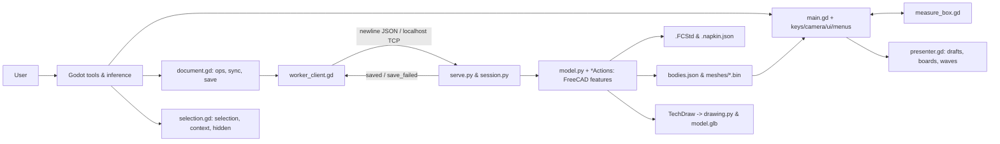

# Napkin architecture

Map of the current implementation: component boundaries, state ownership, data flow, communication, and persistence.

## Documentation ownership

| Question | Read / maintain here |
|---|---|
| Install and use the app | [README.txt](README.txt) |
| Worker queue & integrator steps | [BOARD.md](BOARD.md), [docs/integrator.md](docs/integrator.md) |
| Workflow, tests, agent rules | [CLAUDE.md](CLAUDE.md), [AGENTS.md](AGENTS.md), [GEMINI.md](GEMINI.md) |
| Folder rules, traps, test coverage | [worker/CLAUDE.md](worker/CLAUDE.md), [viewport/CLAUDE.md](viewport/CLAUDE.md), [viewport/tools/CLAUDE.md](viewport/tools/CLAUDE.md) |
| Component fit & state ownership | This architecture map |
| Rulings, Work list, questions | [Decision log](03_Past_Decisions/decision-log.md), [archive](03_Past_Decisions/decision-archive.md) (`tools/log.py`, `tools/sort_decision_log.py`) |
| Delivery handoffs & wire protocol | [Handoff](docs/agent-handoff.md), [Protocol](docs/protocol.md) |
| Proposals & FreeCAD capabilities | [Suggestions](<Codex's suggestions.md>), [U01](docs/specs/U01-history.md), [FREECAD_FEATURE_MAP.md](FREECAD_FEATURE_MAP.md) |

## System overview

Local desktop app: one Godot process per window, a shared FreeCAD worker for compatible windows, and file-based geometry transfer on the same local filesystem. Godot owns immediate interaction; FreeCAD runs authoritative operations on native `.FCStd` documents (editable in FreeCAD). Blender is a rendering consumer.

## Module map (generated)

One-line index per module (`tools/architecture_map.py`). Per-file details, warnings, and entry points live in each file's header.

<!-- module map: built by tools/architecture_map.py; don't edit by hand -->

- `viewport/appearance.gd` — Wood library, board materials, and Paint and grain commands (T15, M03)
- `viewport/camera_rig.gd` — Orbit, pan and zoom for mouse and trackpad (T113)
- `viewport/document.gd` — The document controller (A31, T39): one model's action list and its sync with FreeCAD
- `viewport/history.gd` — History & worker replies: open, undo, redo, worker sync dispatch, and confirmed-board glue (`m.history`)
- `viewport/inference.gd` — The one snapping and inference engine every tool uses (T4, Q16): what's under the cursor (pick), point snaps in SketchUp's order (endpoint > midpoint > on edge…
- `viewport/keys.gd` — The keyboard (T75): tool keys (each tool declares its own, tool_registry.gd), shortcuts, Esc, Enter, Delete / Backspace, typed values, Tab / ⌥ for Push/Pull
- `viewport/live_preferences.gd` — Live preferences (I63, T111): loads, watches and applies user://preferences.json to live tunables and default units
- `viewport/main.gd` — Napkin: tool-first viewport
- `viewport/measure_box.gd` — The measurements box (VCB, T75): the typed value at the bottom right, what it's labelled, and where the typed text goes
- `viewport/menus.gd` — The native menu bar and menu command dispatch (T113)
- `viewport/model_files.gd` — Model files: settings, last model, output folders, window title, and switching models (`m.files`)
- `viewport/preferences.gd` — User preferences (I63, T111): reads, validates, watches and seeds a JSON file with default units and input-feel tunables
- `viewport/presenter.gd` — Geometry presentation (A33b, T41), `m.pres`: what the model looks like on screen
- `viewport/profiles.gd` — Drawn profiles (rectangles, circles, polygons, lines and arcs), `pres.profiles`: owns `rects` and `loose_lines`, their drafts, loop fills, and op cleanup
- `viewport/property_panel.gd` — Native FreeCAD properties
- `viewport/regions.gd` — Planar arrangements in model mm (I51)
- `viewport/rejections.gd` — Rejection handling: status notes, forced-rejection test hook, and rejection-wave cleanup (`m.rejections`)
- `viewport/save_prompts.gd` — Closing-save and outside-save prompts (I55, A36): asks when a closing save stalls or FreeCAD saves with actions pending, and runs reload or keep-mine
- `viewport/selection.gd` — Selection and context (A33b, T41): what a click stands for and what's picked
- `viewport/selection_view.gd` — Selection, context and sibling highlights (A33b), `pres.selection_view`: draws selection, ghosting, hidden boards, mirror plane and siblings from selection.gd
- `viewport/tests.gd` — Test-mode entry point
- `viewport/tool_context.gd` — What a tool may use (T88, docs/specs/T88-tool-interface.md): one ToolContext, built once by main.gd and handed to every tool by `setup_context(ctx)`
- `viewport/tool_geometry.gd` — Pure geometry shared by tools, inference and main.gd (T88 step 0): units, rounding for ops, plane bases, prisms, feature edges, reflections
- `viewport/tool_registry.gd` — The tool registry: every script in tools/ that declares a `TOOL` constant is a tool (see tools/CLAUDE.md)
- `viewport/ui.gd` — The viewport interface (T24: Mac-like)
- `viewport/units.gd` — Lengths are millimetres internally
- `viewport/waves.gd` — Confirmation and rejection waves (W01–W09), `pres.waves`: runs the shader wave front on drafts/boards, breathes while FreeCAD works, and finishes or goes red
- `viewport/worker_client.gd` — Newline-delimited JSON client for the FreeCAD worker (worker/replay.py)
- `viewport/worker_process.gd` — FreeCAD worker process lifecycle (T6, W13): probes or starts the shared or private worker, watches and restarts it, and shuts it down on quit

- `viewport/tools/arc_tool.gd` — I60: both gestures save the start, halfway point and end of one circular arc
- `viewport/tools/circle_tool.gd` — Circle (C): centre, then radius; the same click/drag gesture as Rectangle (I43)
- `viewport/tools/line_tool.gd` — I58: click-click chain or a single press-drag-release segment
- `viewport/tools/move_tool.gd` — Move (M), SketchUp style: grab a point on a board (or a hole's wall: the hole), move, click or type a distance
- `viewport/tools/paint_tool.gd` — Paint: click a board to give it the wood picked in the Wood menu (T15)
- `viewport/tools/polygon_tool.gd` — Polygon (T84, I64): centre, then circumradius; Circle's click/drag gesture (I43)
- `viewport/tools/push_tool.gd` — Push/Pull (P): click a face, rectangle or circle, move, then click or type a distance + Return (minus = cut)
- `viewport/tools/rect_tool.gd` — Rectangle (R): click a face or the ground, then click or type  width, height  + Return
- `viewport/tools/select_tool.gd` — Select (Space): click a drawing or a board (from outside, its whole assembly or array row) to select it; Shift-click adds or removes; click empty space to clear
- `viewport/tools/tool.gd` — A tool owns its state; main.gd hands it the cursor, clicks, keys and typed values (T4)

- `worker/arc.py` — Saved circular drawings (T83)
- `worker/assembly.py` — Assemblies (T20): grouping boards and moving a group with its arrays
- `worker/circle.py` — Exact editable circle profiles (T81); only the viewport tessellates them (its 64-sided disk's facets never enter the native circle operation)
- `worker/common.py` — Shared by every worker module: FreeCAD, units and tolerances, OpError, Frame, the wood cards
- `worker/deletion.py` — T34, I46: Delete
- `worker/drawing.py` — Compose a shop drawing (A3, third-angle) from the worker's outputs
- `worker/export.py` — Outputs for the viewport and renders: bodies.json entries, mesh files, model.glb, the TechDraw page
- `worker/field_audit.py` — Runtime audit of op fields sent to Model.apply vs actually read by handlers
- `worker/length_input.py` — Length-only evaluation using FreeCAD; no model-property references
- `worker/line.py` — Saved, editable straight drawings and polygon profiles (T82)
- `worker/materials.py` — Napkin's wood library (T15, M03): one table, written out as FreeCAD material cards (.FCMat) where FreeCAD looks for user materials, and as materials.json for t…
- `worker/mirror.py` — Mirrored copies (Part::Mirroring) and mirror groups (A11b, T26)
- `worker/model.py` — Model: Napkin operations on a FreeCAD document
- `worker/move.py` — Move and copy: moving boards and holes, linked copies and arrays (A22c, T12), detach and make unique
- `worker/object_properties.py` — Inspectable native properties and journalled edits, shared by the worker and tests
- `worker/op_contracts.py` — Per-op contracts (H189-H194): collect CONTRACT dicts from worker handler modules into tests/op_contracts.json, and validate(op), which Model.apply runs before…
- `worker/paint.py` — Paint and grain (T15, M03): materials on a board definition, grain directions
- `worker/plane_fit.py` — Board-local face references for Napkin stock and extruded/cut boards
- `worker/polygon.py` — Exact editable regular polygon profiles (T84): a native constrained sketch, like circle.py's circles
- `worker/push.py` — Rectangles and Push/Pull: new boards, cuts and joins, through-cuts (I24), pocket-floor ties (T59)
- `worker/replay.py` — Napkin worker: keeps a live FreeCAD document and edits it with native features
- `worker/serve.py` — The connection loop: one worker serving every window (W13), and the one-off replay (main)
- `worker/session.py` — Session: one live document bound to one .FCStd file; sync, undo, journal, saving (A23, A42)
- `worker/update_old_files.py` — One-time updater for pre-H199/H204 saved files (.FCStd and .json) (T159, T139, A43, G09); session.py reads its old-name tables to refuse a file not yet updated
- `worker/visibility.py` — Hide and unhide (T28, I37): SketchUp-style hiding, kept as a board property so it is undoable and saved

- `tools/architecture_map.py` — Generate and check the module map in ARCHITECTURE.md from each code file's own header line (T138)
- `tools/build_app.sh` — Builds "dist/Napkin.app" for this Mac: the viewport packed into Resources, run by a copy of the Godot program (no export templates needed), plus the FreeCAD wo…
- `tools/check_architecture.py` — Flag code changes whose architecture impact must be reviewed
- `tools/comitatus_commit.py` — Commit generated files in the comitatus repo (William, 2026-11-26: "commit the generated files automatically")
- `tools/compare_suites.py` — Compare viewport suite results with the reference runs: python3 tools/compare_suites.py <runs dir> [suite...] Each suite's final boards must match (volume with…
- `tools/dependency_map.py` — Generate and check docs/dependency-map.md, and find callers / Touches lines
- `tools/featuretest.sh` — Feature tests (~34 s): everything that checks Napkin's answers with no window, all side by side
- `tools/front_sim.py` — Simulate the wave-front controller to tune smoothness before porting to GDScript
- `tools/fulltest.sh` — Full check (~20 s): when tools/quicktest.sh fails, or before a merge
- `tools/gate.sh` — The merge gate (P18): quick then full, one verdict; successful quick checks are reused (T90)
- `tools/handoff.py` — The handoff's entries, one file each (T77): docs/handoff/H037-short-slug.md holds one entry, headed "### H037 — Subject" with the usual Author | Date | Status…
- `tools/hopper_picture.py` — Draw the job queue as a four-part ASCII picture (H203): hopper, workbench, questions, integrator's desk; reads the queue through job.py, and job.py's hopper wi…
- `tools/hopper_settings.py` — The hopper's settings (P78): read tools/hopper_settings.toml, checked value by value against the built-in defaults
- `tools/integrate.py` — Merge one agent branch into main (P20): the integrator's steps, in one command
- `tools/integrator.py` — Who is the integrator (P19): one lock, shared by every worktree (it lives in git's common folder, untracked)
- `tools/job.py` — The job queue (P24): a worker takes a job and says done; a dead man's switch flags one gone quiet
- `tools/launch.py` — Start a worker session with its start-up brief already in its first message (T134), so it skips the start-up round and can't skip the brief
- `tools/length_cases.py` — Writes tests/length_cases.json: what FreeCAD's length input (worker/length_input.py evaluate) gives for a fixed set of typed lengths, plus random expressions b…
- `tools/line_trace.py` — Run a Python test script under sys.settrace and record executed lines and functions
- `tools/log.py` — Add to and read the decision log (T92, P09, P23) without editing its tables by hand
- `tools/number_ids.py` — Give placeholder IDs their numbers at merge (T74), so two branches never take the same number
- `tools/org_todos.py` — Fill comitatus/06_To-dos (T134, P57's way): one file per thing waiting on someone, from this code base's main
- `tools/parsecheck.sh` — Loads every viewport script once, headless, and prints any parse error
- `tools/personal_space.py` — Personal spaces (T134, T150): one folder per member in comitatus/04_Personal_Space/<name>/ (opus-integrator, gemini-coder, ...), each with a Log.md (what you d…
- `tools/protocol_map.py` — Generate and check the protocol message table and references in docs/protocol.md (H169)
- `tools/quicktest.sh` — Quick check, after every change (~12 s): the feature tests (tools/featuretest.sh: every test_* file in worker/, tools/ and viewport/, no window) beside the UI…
- `tools/reading_cost.py` — Measure observable repository reads in saved worker transcripts (H216)
- `tools/sort_decision_log.py` — Keep the decision log tidy (P23): two files with the same IDs, 03_Past_Decisions/decision-log.md (live) and 03_Past_Decisions/decision-archive.md (history)
- `tools/start_worker.sh` — Opens a Terminal window running a Claude worker with Remote Control (F005, P38): the same as typing cd <this checkout> ; claude ; /remote-control ; Check the b…
- `tools/startup.py` — Session startup report (T56): run this instead of reading the big documents
- `tools/<NAME>.py|.sh` — one named script per action, listed in tools/README.md (H154)

<!-- end module map -->

## Protocol at a glance

Newline JSON over localhost TCP. `worker_process.gd` probes port 7878 (`hello`) and shares the worker only if `PROTOCOL_VERSION` (`serve.py`/`main.gd`) and `worker_identity` (MD5 of non-test `worker/*.py`) match; otherwise it starts a private worker (`SERVE_PORT=0` + `SERVE_PORT_FILE` in tests). `serve.py` multiplexes sockets with `select` and runs geometry serially. See [docs/protocol.md](docs/protocol.md) for commands, `length`/`inspect_properties`/`property_edit`, selection/delete, plane-fit/to-face/hide, and journal/export schemas.

## State ownership and authority

| State | Owner | Meaning |
|---|---|---|
| Pointer gesture, typed text, hover, preview | Godot tool / `main.gd` | Provisional user interaction |
| Desired operation sequence & `redo_stack` | Godot `document.gd` | What client wants materialized; linear in-memory redo |
| Selection, context, hidden set, relationships | Godot `selection.gd` | Click unit; hidden/deleted follow `ops` immediately |
| Accepted geometry & relationships | Live FreeCAD document | Authoritative computed model |
| Saved model & provenance | `.FCStd` & `.napkin.json` | Durable native model, ops, revision, hash, undo floor |
| Meshes, bounds, GLB, TechDraw views | Derived export files | Rebuildable presentation/export products |
| Confirmed visible states (up to 40) | Godot `presenter.gd` | Fast undo/redo restoration; not durable history |
| Last model / units / preferences | `user://settings.cfg`, `preferences.json` | App preferences |

Confirmed ≠ saved. Draft ≠ accepted solid. Mesh cache ≠ durable feature history.

## Lifecycle of an edit

1. Tool receives input via `main.gd`/`tool_context.gd` and snaps via `inference.gd` (Z-up mm in model, Y-up m in Godot; `Frame`/`edit_frame()` map world ↔ definition coords).
2. Tool renders a draft (`presenter.gd`) and appends an op to `document.gd:ops`.
3. `document.gd:sync()` bumps `seq` and sends ops when nothing is in flight; further edits coalesce.
4. `Session.sync()` diffs against applied ops, undoes the tail, or rebuilds from empty or `<model>.floor.FCStd`.
5. Each op runs in a FreeCAD transaction (`Model.HANDLERS`); failure aborts that op.
6. `export.py` writes `bodies.json` and changed `meshes/*.bin`; worker replies with per-op status and `outdir`.
7. `document.gd:on_sync_reply()` forwards only a reply for current `seq` with nothing newer waiting; only the in-flight reply clears `in_flight`; `open` gates on `is_current_open`. `presenter.gd` replaces drafts with confirmed nodes and runs rejection waves.
8. After 0.25 s of socket quiet, `serve.py:save_pending` saves dirty models and emits `saved` (or `save_failed`).

Typed lengths evaluate locally first (`units.gd:evaluate_length`, matching `length_input.py` via `tests/length_cases.json`); declined inputs go asynchronously as `length` (cancelled on new input, independent of geometry `in_flight`). `property_edit` runs through normal `sync`/export; `plane_fit.py` resolves target faces geometrically (`SSTargetNormal`/`SSTargetPoint`) and refits chains in topological order.

## Files, persistence and recovery

- **Atomic generations**: `Session.save()` writes `<model>.saving.FCStd` and `.napkin.saving.json`, links current files to `.prev.*`, and renames new files into place so a whole pair is always on disk. `model.glb` writes only when `glb_dirty` or missing; `Session.drawing` is one-shot.
- **Recovery**: `recover_generation()` picks the newest readable pair (`.FCStd` ZIP + `Document.xml`), finishes interrupted `.saving` saves, falls back to `.prev` only if main is missing/unreadable, and opens unexpected FreeCAD edits with an undo floor.
- **Outside saves**: `serve.py` stats owned models every 0.25 s, holds modified models (`outside_sha256`), and sends `outside_save`. `document.gd` / `save_prompts.gd` reload at once if idle, or wait/ask (`reload_outside` writes `<model>.floor.FCStd` and moves newer ops to `dropped`; `keep_mine` copies FreeCAD's file aside and overwrites).
- **Save failures & close**: Failed saves stay pending (retried on next `sync`/`flush`/`bye`/`quit`, skipped by autosave timer) and show `save_error` until `saved`. Window close waits for `flush` and prompts (`CLOSE_WAIT_S`) if saving stalls.

## Where to implement a change

| Change | Start here | Also check |
|---|---|---|
| New tool | New script in `viewport/tools/` with `TOOL` constant | `inference.gd`, `Model.HANDLERS`, rejection deps, `test_tools.gd` |
| Snap / inference | `viewport/inference.gd` | Tools, coordinate conversions |
| Native feature | `op_<type>` in `worker/*.py` `*Actions` mixin | Transactions, `export.py` cache keys, persistence/reopen |
| Typed length syntax | `worker/length_input.py`, then `viewport/units.gd` | `tools/length_cases.py`, `measure_box.gd` |
| Native properties / fits | `viewport/property_panel.gd`, `worker/object_properties.py`, `plane_fit.py` | Shared definitions, frames, `expected` check |
| Protocol / exports | Producer & consumer together + `docs/protocol.md` | `PROTOCOL_VERSION`, `meshes/*.bin`, `bodies.json` |
| Packaging / tests | `tools/build_app.sh`, `tools/gate.sh` | [CLAUDE.md#tests](CLAUDE.md#tests), `tools/check_architecture.py` |

## Architectural constraints worth preserving

- Input stays responsive while FreeCAD evaluates; provisional, confirmed, and saved states are distinct.
- Every op is transaction-safe and leaves the prior model valid on rejection.
- `.FCStd` is authoritative; mesh caches and `redo_stack` never replace durable history.
- Tools use only `ToolContext` (never `Main`) and share `inference.gd` / `tool_geometry.gd`.
- Cross-boundary changes update both producer and consumer (`PROTOCOL_VERSION`, mesh layouts, cache keys, save/recovery).
